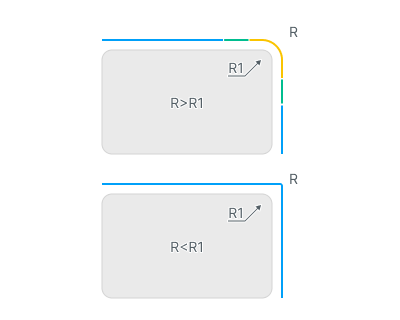
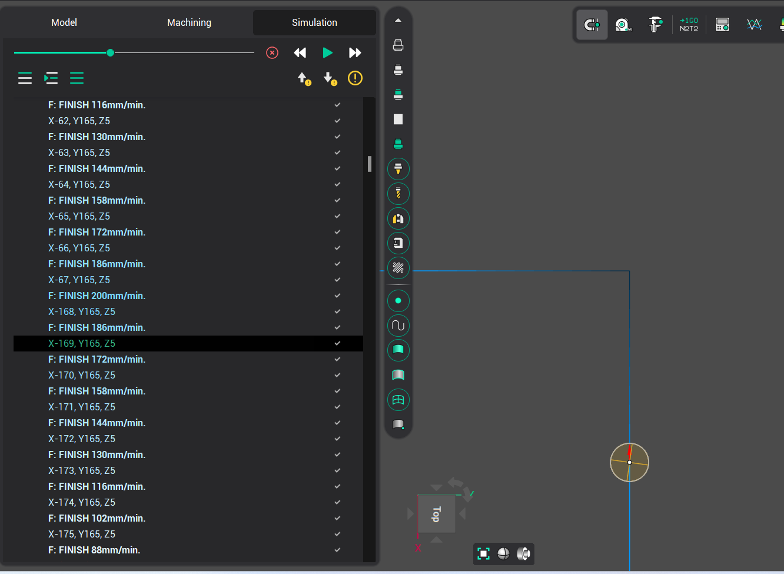

# コーナーコントロール

.png) .png)

## 適用分野：

このパラメータグループは、ツールパスコーナーに特定の動作を追加することができます。「送り速度/回転数」ページの下部にあります。

> 注意
>
> コーナーコントロールは、"パラメータ" ページの "<strong>効果的な送り</strong>" パラメータで設定できる有効送りを持つツールパスセグメントにのみ適用されます。
>
> 削り出し加工において、デフォルトの「効果的な送り」セットには以下が含まれます。
>
> - ワークの送り
> - 切込み／退避送り
> - 加工開始パス送り速度
> - 仕上げ送り速度

コーナーコントロール "オプションに対応する全操作リストは下記をご参照ください：

詳細を表示

- <strong>2D</strong>
  - 2D輪郭
- <strong>2.5D</strong>
  - 2.5D輪郭
- <strong>3D</strong>
  - 3D輪郭
- <strong>3D/5Dアドバンス</strong>
  - 6D輪郭
- <strong>4Dロータリー</strong>
  - 4D輪郭
- <strong>取り残し加工</strong>
  - 面取り
- <strong>カッティング</strong>
  - ジェット加工
  - 5Dジェット加工
- <strong>積層</strong>
  - エリアクラッディング
  - カーブクラッディング
  - 3D クラッディング
  - 5D クラッディング
  - 非平面スライス
- <strong>溶接</strong>
  - 6D 溶接
- <strong>スプレー</strong>
  - 輪郭スプレー
  - サーフェススプレー
  - モーフスプレー
  - ロータリースプレー
- <strong>レガシー</strong>
  - 5D溶接
  - 5D輪郭

コーナーをコントロールするためのパラメーターには、主に「<strong>検出方法</strong>」と「<strong>アクションタイプ</strong>」の2つのグループがあります。

## 検出方法：

”検出方法”パラメータグループは、システムにコーナーの検出方法を指示します。現在、利用可能なパラメータは<strong>「角度別」</strong>のみです。

### 角度別

_(By_angle).png)

<strong>角度別</strong> パラメータは、角度の値を度単位で定義します。ツールパスの連続する2つの区間は、それらの間の角度が設定値以下であれば「コーナー」として検出されます。

_(Angle).png)

例えば、"角度 "の値が110度に設定されている場合、102度の値を持つ最初の角度は、システム内でコーナーとしてマークされます。

さらに、より精密に調整するための2つの追加パラメータがあります。"<strong>最小直線の長さ</strong>"と"<strong>最小円弧半径</strong>"です。

<strong>最小直線の長さ</strong>パラメータは、コーナー検出アルゴリズムを実行する前に、希望する許容誤差(または最小線長)値を使用してツールパスを滑らかにします。検出方法は平滑化されたツールパスに適用されるため、誤ったコーナー検出や見逃しを防ぐことができます。<em>注意：このパラメータは最終的なツールパスには影響しません。内部検出アルゴリズムにのみ使用されます。</em>

<em>_(Minimum_line).png)</em>

**最小円弧半径。** 丸められたコーナーを検出するための半径しきい値**R**を設定します。図中の**R1**は、モデルのフィレット半径です。

- **R > R1：** フィレットをコーナーとして扱い、選択した**Action type**を適用します。
- **R < R1：** この半径の判定基準では、フィレットをコーナーとして扱いません。

## アクションタイプ：

"アクションタイプ "グループのパラメータで、ツールパスのコーナーでのシステムの動作を選択できます。3つのモードがあります。"<strong>送りを調整</strong>", "<strong>パワーを調整</strong>", "<strong>送りとパワーを調整</strong>”

> Note
>
> 最後の2つのモード（<strong>パワーを調整</strong>および<strong>送りとパワーを調整</strong>）は、<strong>5Dクラッディング</strong>および<strong>非平面スライス</strong>のオペレーションでのみ使用可能であり、かつ<strong>パラメータ</strong>ページで<strong>パワー</strong>機能が有効になっている場合に限り利用できます。

このグループは、<strong>指定値</strong>、<strong>ステップの数</strong>、<strong>ステップ長さ</strong>の3つのオプションで構成されています。

### 送りを調整、パワーを調整,、送りとパワーを調整

これらのモードでは、検出したツールパスのコーナーで、送り速度とパワーを段階的に調整できます。それぞれを個別に、または同時に調整できます。

_(Slowdown_feed_by_step).png)

<strong>指定値</strong>は、検出したコーナーでの目標値を、基準となるパラメータに対する割合で定義します。100%未満ではパラメータを減らし、100%を超えると増やします。

_(Slowdown_percentages).png)

<strong>ステップの数</strong>は、目標値に到達するまでの段階数を定義します。

_(Number_of_steps).png)

<strong>ステップの長さ</strong>は、1ステップの長さを定義します。

_(Step_length).png)

これらのパラメーターを使った結果は「シミュレーション」ページで確認できます。コーナーのツールパスセグメントはカラーグラデーションで表示されます。また、CLDATAに追加された送りが削減された新しいコマンドも、カラーグラデーションでマークされます。

