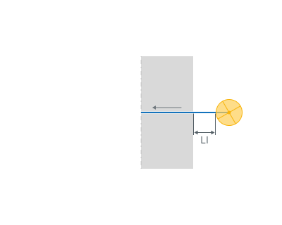
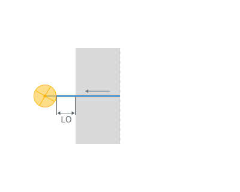

# An- und Abfahrbewegungen beim Planfräsen

## Anwendungsbereich:

Ergänzt Arbeitsbahnen um Einfahr- und Abfahrbewegungen.

**Lead in (Einfahren).** Abstand vom Rohteil, an dem die Arbeitsbahn beginnt. Er verhindert ein senkrechtes Eintauchen des Werkzeugs in das Material.

**LI –** Einfahren

**Lead out (Abfahren).** Abstand vom Rohteil für das Ende der Arbeitsbahn und das anschließende Verlassen des Bearbeitungsbereichs.

**LO –** Abfahren
