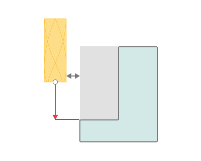
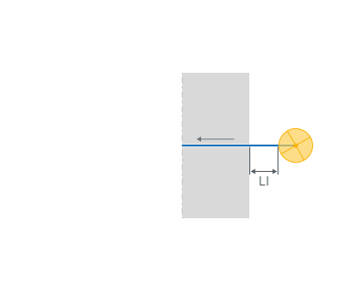
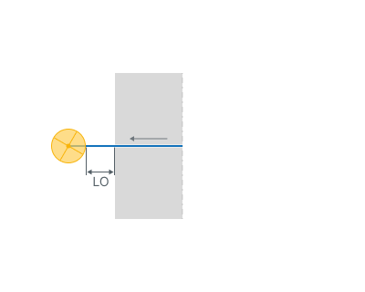

# Leads based on the Face Milling

## 

## Application Area:

Allows you to add additional engage and retract to the working moves.

**Lead in.** The distance from the workpiece at which a work pass starts. Used to avoid vertical plunging of the tool into material.

**LI** - Lead in

**Lead out.** The distance from the workpiece at which a work pass starts. Used to avoid vertical plunging of the tool into material.

**LO** - Lead out
