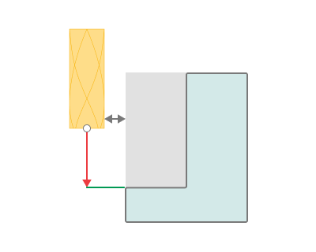
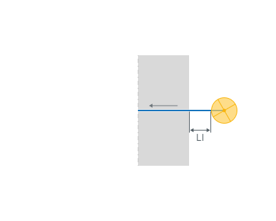
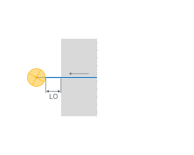

# フェイスミルに基づくリード

## 

## 適用分野:

加工移動に追加の切込みおよび退避動作を追加します。

<strong>進入</strong> 加工パスを開始するワークからの距離を設定します。工具が素材へ垂直に突込むのを防ぐために使用します。

<strong>LI</strong> - 進入

<strong>退出</strong> 加工パスを開始するワークからの距離を設定します。工具が素材へ垂直に切込むのを防ぐために使用します。

<strong>LO</strong> - 退出
