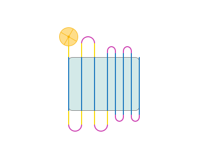
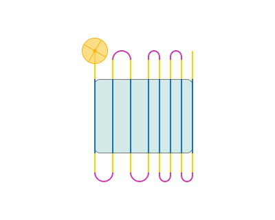
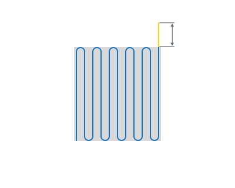
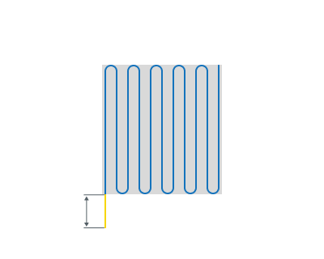

# An- und Abfahrbewegungen beim Auftragsschweißen

**Sl –** Sicherheitshöhe

**LD –** An- und Abfahrbewegungen

## Anwendungsbereich:

Ergänzt Arbeitsbahnen um Einfahr- und Abfahrbewegungen mit den dafür eingestellten Vorschüben.

**Engage (Einfahren).**

Weitere Informationen anzeigen

**Off (Aus).** Die betreffenden Engage- und Retract-Abschnitte werden nicht erzeugt.

.png)

**By Line (Geradlinig).** Einfahren zum ersten Arbeitsbahnpunkt unter einem Winkel zur Vertikalen.

.png)

**By Arc (Kreisförmig).** Ergänzt am ersten Kurvenpunkt einen Bogen mit vorgegebenem Radius. Der Winkel wird von der Tangente der Arbeitsbahn aus bestimmt.

).png)

**Length / Radius (Länge / Radius).** Legt die Länge bzw. den Radius fest.

.png) .png)

**Angle (Winkel).** Legt den vertikalen Winkel fest.

.png)

**Retract (Abfahren).**

Weitere Informationen anzeigen

**Off (Aus).** Die betreffenden Engage- und Retract-Abschnitte werden nicht erzeugt.

.png)

**By Line (Geradlinig).** Abfahren vom letzten Arbeitsbahnpunkt unter einem Winkel zur Vertikalen.

.png)

**By Arc (Kreisförmig).** Ergänzt am letzten Kurvenpunkt einen Bogen mit vorgegebenem Radius. Der Winkel wird von der Tangente der Arbeitsbahn aus bestimmt.

).png)

**Length / Radius (Länge / Radius).** Legt die Länge bzw. den Radius fest.

.png) .png)

**Angle (Winkel).** Legt den vertikalen Winkel fest.

.png)

**Use leads for (Leads verwenden für).**

Weitere Informationen anzeigen

**Long links (Lange Verbindungen).** Verwendet Leads nur bei langen Verbindungen.

**Long and Short links (Lange und kurze Verbindungen).** Verwendet Leads bei beiden Verbindungstypen.

**Overlaps (Überlappungen).**

Weitere Informationen anzeigen

**Entry overlap (Überlappung am Anfang).** Legt eine Überlappung am Bahnanfang fest.

**Exit overlap (Überlappung am Ende).** Legt eine Überlappung am Bahnende fest.

**Use leads for short links, aktiviert:** Ergänzt auch kurze Verbindungen um Leads.

**Deaktiviert:** Leads werden nur bei langen Verbindungen und an den Ein- bzw. Austrittspunkten verwendet.

.png) .png)
