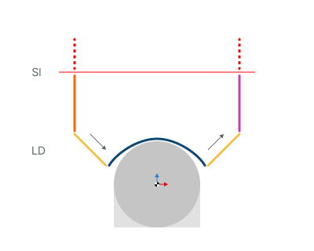
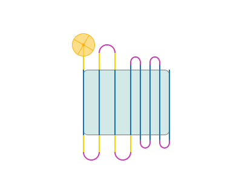
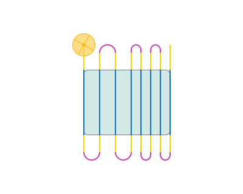
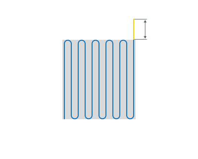
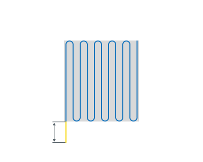

# クラッディング加工のリード

<strong>Sl</strong> - 安全高さ

<strong>LD</strong> - リード

## 適用分野:

加工送り速度を使用して、加工移動に進入動作および退避動作を追加できます。

<strong>切り込み</strong>

拡大

<strong>オフ</strong> 切込みおよび退避のツールパスは生成されません。

<strong>直線</strong> 切込みは、最初の加工点に対して垂直方向から指定した角度で行われます。

<strong>円弧</strong> 指定した半径を使用して、曲線の最初の点に円弧を追加します。円弧の角度は、加工パスの接線方向に基づいて生成されます。

<strong>長さ(半径)</strong> 長さを変更します。

 

<strong>角度</strong> 垂直方向に対する角度を変更します。

<strong>退避</strong>

拡大

<strong>オフ</strong> 切込みおよび退避のツールパスは生成されません。

<strong>直線</strong> 退避は、最後の加工点に対して垂直方向から指定した角度で行われます。

<strong>円弧</strong> 指定した半径を使用して、曲線の最後の点に円弧を追加します。円弧の角度は、加工パスの接線方向に基づいて生成されます。

<strong>長さ(半径)</strong> 長さを変更します。

 

<strong>角度</strong> 垂直方向に対する角度を変更します。

<strong>リードを使用</strong>

拡大

<strong>ロングリード リードは、ロングリンクに対してのみ適用されます。</strong>

<strong>ロングリンクとショートリンク</strong> ロングリンクとショートリンクの両方に適用されます。

<strong>オーバーラップ</strong>

拡大

<strong>開始オーバーラップ</strong> 開始位置でのオーバーラップ量を設定します。

<strong>終了オーバーラップ</strong> 終了位置でのオーバーラップ量を設定します。

<strong>ショートリンクにリードを使用 有効:</strong> 有効にすると、短いリンク移動を含むすべてのリンクにリードが追加されます。

<strong>無効:</strong> 無効にすると、リードは長ロングリンクおよび進入／退出リンクにのみ追加されます。

 
