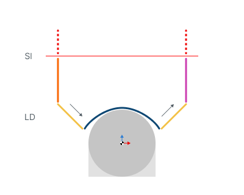
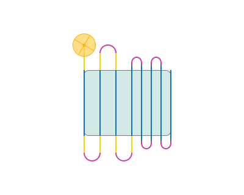
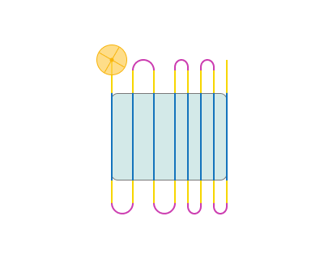
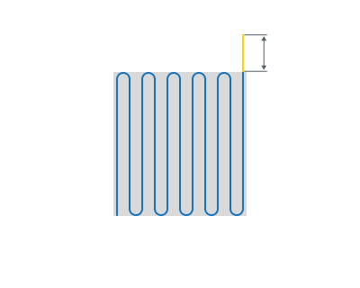
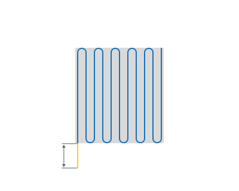

# Leads for сladding operations

**Sl** - Safe level

**LD** - Leads

## Application Area:

Allows you to add additional engage and retract to the working moves using their feed.

**Engage.**

Click here to expand..

**Off.** The Engage and Retract toolpath parts is not generated.

.png)

**By Line.** The engage is performed by angle to vertical to the first machining point

.png)

**By Arc.** The system adds an arc to the first point on the curve using the defined radius. The arc angle is constructed from the tangent of the work pass.

).png)

**Length (Radius).** Changes the length

.png) .png)

**Angle.** Changes the vertical angle

.png)

**Retract.**

Click here to expand..

**Off.** The Engage and Retract toolpath parts is not generated.

.png)

**By Line.** The retract is performed by angle to vertical to the last machining point

.png)

**By Arc.** The system adds an arc to the last point on the curve using the defined radius. The arc angle is constructed from the tangent of the work pass.

).png)

**Length (Radius).** Changes the length

.png) .png)

**Angle.** Changes the vertical angle

.png)

**Use leads for.**

Click here to expand..

**Long links.** Leads is used only on the Long links.

**Long and Short links.** Leads is used on both Long and Short links.

**Overlaps.**

Click here to expand..

**Entry overlap.** Allows you to set an overlap at the beginning.

**Exit overlap.** Allows you to set an overlap at the end.

**Use leads for short links. Enable:** When enabled leads are added to all links, including the short ones.

**Disable:** When disabled leads are added only to long links and entry/exit inks.

.png) .png)
