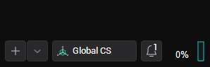
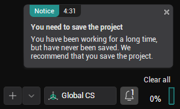

# アプリケーションイベント通知

<strong>ポップアップ通知</strong>という、特に注意が必要なアプリケーションのイベントをユーザーに知らせる機能があります。イベントが発生すると、メインウインドウの右下に小さなウインドウがポップアップ表示され、イベントの簡単な説明が表示されます。コーナーにあるアイコンは、このような通知の総数も表示します。これをクリックすると、通知の一覧を表示するパネルを開くことができます。

  
