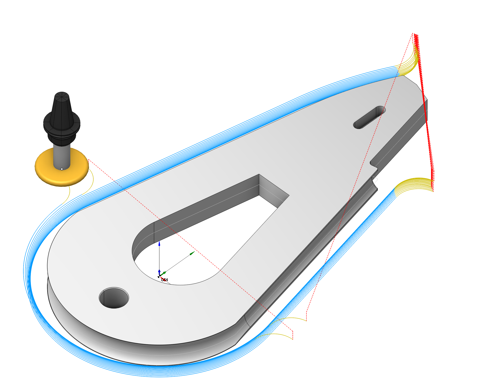
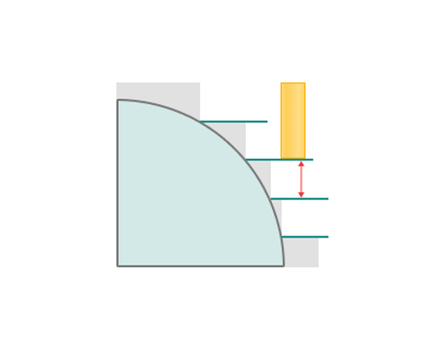
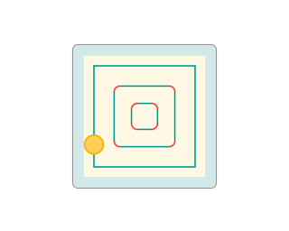

# Finitura a Z costante in sottosquadro

## Ambito di applicazione:

L'operazione <strong>Waterline undercut operation</strong> (lavorazione a Z costante in sottosquadro) serve a realizzare recessi, gole o cavità con una fresa. L'operazione genera un percorso utensile a Z costante per gli <strong>undercut tools</strong> (utensili per sottosquadri).

### Configurazione:

La scheda <strong>Setup</strong> serve a configurare i parametri principali del progetto, ad esempio il posizionamento del pezzo sulla macchina, il sistema di coordinate del pezzo e altro ancora. [Dettagli](1022.md)

### Assegnazione del lavoro:

<strong>Faces.</strong> (facce) Selezionare diverse superfici del pezzo come oggetto della lavorazione. Il sistema calcolerà il percorso utensile in base alle superfici scelte. [Dettagli](102121.md)

<strong>Job Zone.</strong> (zona di lavoro) Le zone di lavoro servono a definire le aree del pezzo che devono essere lavorate dalle operazioni di fresatura di sgrossatura e di finitura. [Dettagli](10151.md)

<strong>Restrict Zone.</strong> (zona di esclusione) Oltre alle <strong>Job Zones</strong>, nel sistema è possibile utilizzare le <strong>Restrict Zones</strong> per specificare le aree del grezzo che non devono essere lavorate nell'operazione corrente. [Dettagli](10152.md)

<strong>Top Level.</strong> (livello superiore) Definizione del livello superiore mediante elementi del modello. [Dettagli](10153.md)

<strong>Bottom Level.</strong> (livello inferiore) Definizione del livello inferiore mediante elementi del modello. [Dettagli](10153.md)

<strong>Properties.</strong> (proprietà) Visualizza le proprietà di un elemento. È possibile aggiungere il sovrametallo. Questo menu può essere richiamato anche facendo doppio clic su un elemento dell'elenco.

<strong>Delete.</strong> (elimina) Rimuove un elemento dall'elenco.

<strong>Restrictions.</strong> (restrizioni) Consente di delimitare le aree che non devono essere lavorate. [Dettagli](101231.md)

### Strategia:

#### Depth Step (passo in profondità).

Materiale asportato in una passata lungo l'asse dell'utensile tra il livello superiore (<strong>Top</strong>) e il livello inferiore (<strong>Bottom levels</strong>).

Fare clic qui per espandere..

<strong>Adaptive step.</strong> (passo adattivo) Passata aggiuntiva sul livello superiore o inferiore. Necessaria per la pulizia dei pezzi.

.png) .png)

#### Roughing passes (passate di sgrossatura).

Il percorso utensile viene traslato nel piano di una quantità pari allo spessore definito da 'Roughing step' (passo di sgrossatura).

Fare clic qui per espandere..

<strong>Machining strategy:</strong> (strategia di lavorazione)

<strong>Equidistant.</strong> (equidistante) Lavorazione lungo curve ottenute per offset del contorno del pezzo. [Dettagli](10172.md)

<strong>Adaptive.</strong> (adattiva) La strategia serve ad asportare in modo efficiente grandi volumi di materiale con avanzamenti elevati, profondità di taglio massime (fino alla lunghezza dei taglienti) e larghezze di taglio relativamente ridotte (dal 5% al 30% del diametro dell'utensile). [Dettagli](10171.md)

<strong>Roughing step.</strong> (passo di sgrossatura) Passo tra le passate di sgrossatura.

<strong>Rough rounding radius.</strong> (raggio di raccordo in sgrossatura) Il parametro serve a raccordare gli angoli durante la passata di sgrossatura.

<strong>Linking radius.</strong> (raggio di collegamento) Raggio di collegamento per i collegamenti ('links') e anche per i raccordi degli archi trocoidali.

<strong>Step count.</strong> (numero di passi) Numero di passate di sgrossatura.

<strong>Sorting.</strong> (ordinamento) Questa scheda serve a ordinare le passate visualizzate. Questo gruppo di parametri funziona in modo analogo all'operazione <strong>Waterline roughing operation</strong> (sgrossatura a Z costante). [Dettagli](736.md)

<strong>Check workpiece. If enabled:</strong> (controlla il grezzo; se attivato) Aggiunge il numero di passate in base ai valori dei parametri <strong>Roughing step</strong> e <strong>Step count</strong>, tenendo conto dello spessore del grezzo. Se il numero di passate supera lo spessore del grezzo, le passate aggiuntive che non tagliano il grezzo non vengono eseguite.

.png)

<strong>If disabled:</strong> (se disattivato) Aggiunge il numero di passate in base ai valori dei parametri <strong>Roughing step</strong> e <strong>Step count</strong>, senza tenere conto del grezzo.

.png)

#### Machining levels (livelli di lavorazione).

Definisce l'intervallo di lavorazione lungo l'asse dell'utensile. Questo gruppo di parametri funziona in modo analogo all'operazione <strong>Waterline roughing operation</strong> (sgrossatura a Z costante). [Dettagli](736.md)

#### Milling type (tipo di fresatura).

Può essere impostato in quasi tutte le operazioni, tranne quelle di lavorazione di curve. Consente all'utente di controllare il tipo di fresatura richiesto (concorde o discorde) durante il calcolo del percorso utensile. Questo gruppo di parametri funziona in modo analogo all'operazione <strong>Waterline roughing operation.</strong> (sgrossatura a Z costante) [Dettagli](736.md)

#### Sorting (ordinamento).

Controlla la sequenza delle passate del percorso utensile durante la lavorazione delle superfici. Questo gruppo di parametri funziona in modo analogo all'operazione <strong>Waterline finishing operation.</strong> (finitura a Z costante) [Dettagli](841.md)

### Parametri:

Questa scheda contiene i parametri principali per il controllo del pezzo, del grezzo, delle attrezzature di bloccaggio e di altri elementi, che consentono di modificare il percorso utensile. [Dettagli](100112.md)

### Collegamenti/Attacchi:

Nella scheda Links/Leads si definiscono i parametri dei movimenti rapidi. Questi movimenti comprendono l'avvicinamento dell'utensile dalla posizione di cambio utensile, l'attacco all'inizio della corsa di lavoro, la retrazione dopo l'ultimo movimento di taglio, i collegamenti tra le passate di lavoro e il ritorno al punto di cambio utensile. È possibile configurare la sequenza dei movimenti lungo le coordinate, il percorso di questi movimenti e l'entità degli spostamenti.

Fare clic qui per espandere..

<strong>Comprende:</strong>

<strong>Approach/Return.</strong> (avvicinamento/ritorno) Questo gruppo di parametri gestisce i movimenti dell'utensile dalla posizione di cambio utensile all'inizio dei percorsi di attacco e viceversa. [Dettagli](100116.md).

<strong>Links.</strong> (collegamenti) Definisce le regole che governano i collegamenti di entrata/uscita e i collegamenti tra i movimenti di lavoro. [Dettagli](100130.md).

<strong>Leads.</strong> (attacchi) Consente di aggiungere ai movimenti di lavoro ulteriori attacchi e retrazioni eseguiti con il relativo avanzamento. [Dettagli](100136.md).

<strong>Safe motions.</strong> (movimenti di sicurezza) Definisce il tipo di <strong>Safety Surface</strong> (superficie di sicurezza) e la sua distanza dal grezzo. Questa superficie agevola i collegamenti tra le superfici lavorate o tra i percorsi utensile, e la prima fase dell'avvicinamento o del ritorno avviene verso di essa. [Dettagli](100117.md).

<strong>Advanced links settings.</strong> (impostazioni avanzate dei collegamenti) Questo gruppo di parametri specifica le caratteristiche della formazione del percorso utensile soprattutto per le operazioni a cinque assi, tenendo conto dei movimenti ottimali degli assi rotativi. [Dettagli](100118.md).

<strong>Distances.</strong> (distanze) Distanze utilizzate nelle regole dei collegamenti (Links) [Dettagli](100140.md).

### Avanzamenti/Velocità:

In questa finestra di dialogo l'utente può definire la velocità di rotazione del mandrino, il valore di avanzamento dei movimenti rapidi e i valori di avanzamento per le diverse parti del percorso utensile. La velocità di rotazione del mandrino può essere definita come numero di giri al minuto oppure come velocità di taglio. Il valore determinante viene sottolineato. Il secondo valore viene ricalcolato in base al valore determinante, tenendo conto del diametro dell'utensile. [Dettagli](100142.md)

### Trasformazioni:

Insieme di parametri dell'operazione che consentono di eseguire trasformazioni di coordinate sul percorso utensile calcolato nell'ambito dell'operazione. [Dettagli](10168.md)

### Pezzo:

Il pezzo (Part) è un gruppo di elementi geometrici che definisce lo spazio in cui controllare le intaccature. [Dettagli](330.md)

### Grezzo:

Il modello del grezzo (Workpiece) di un'operazione definisce il materiale da lavorare. [Dettagli](738.md)

### Attrezzature:

Come attrezzature (Fixtures) si specificano di solito i dispositivi di bloccaggio, come mandrini autocentranti, griffe, staffe, ecc., e le aree di esclusione di qualsiasi altra natura. [Dettagli](10283.md)
