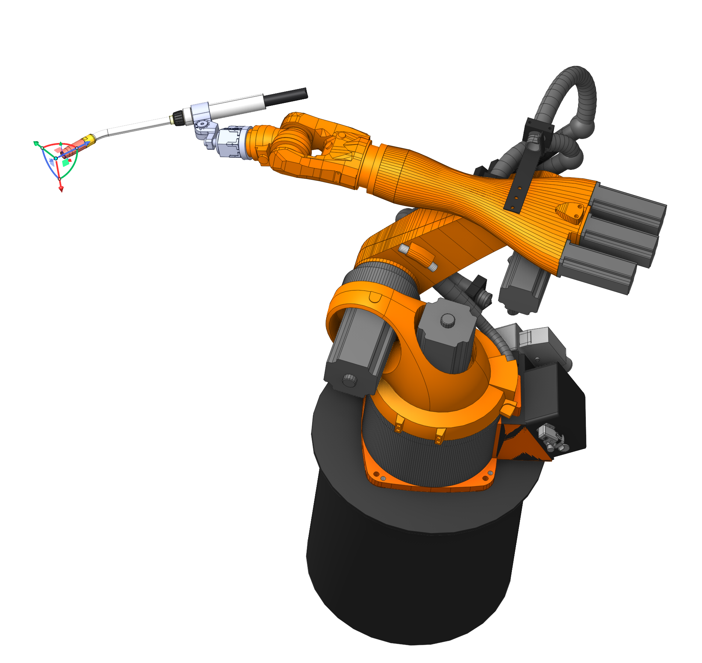
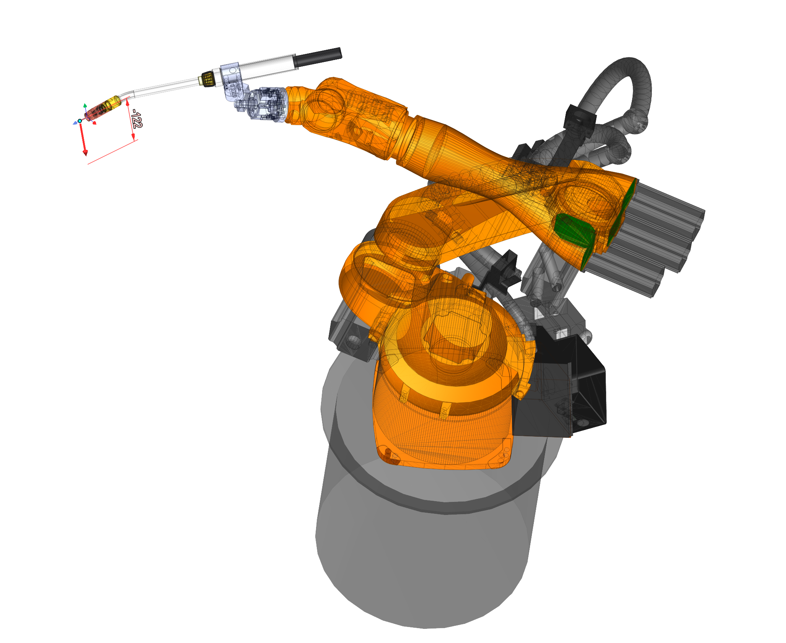
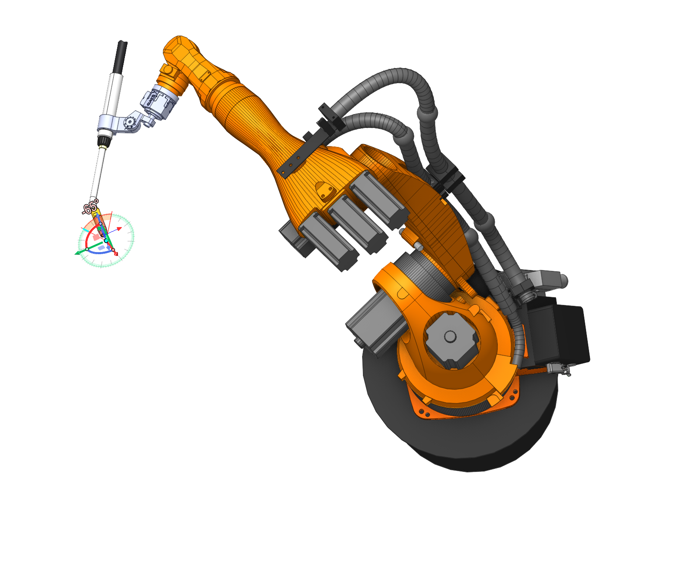

# ギンバル

  

## 適用分野:

3D空間内でオブジェクトを移動、回転させるための視覚的な操作ツールとして、ギンバル（Gimbal）が追加されました。ギンバルを使用することで、オブジェクトの位置や向きを対話的かつ高精度に操作できます。

ギンバルは、次の機能で使用できます。

- ロボットTCPの移動
- カスタムポイントによる第6軸制御の定義
- ポイントによる工具軸制御時のポイント定義
- 工具軸の方向設定
- 治具の配置
