# フィーチャー認識

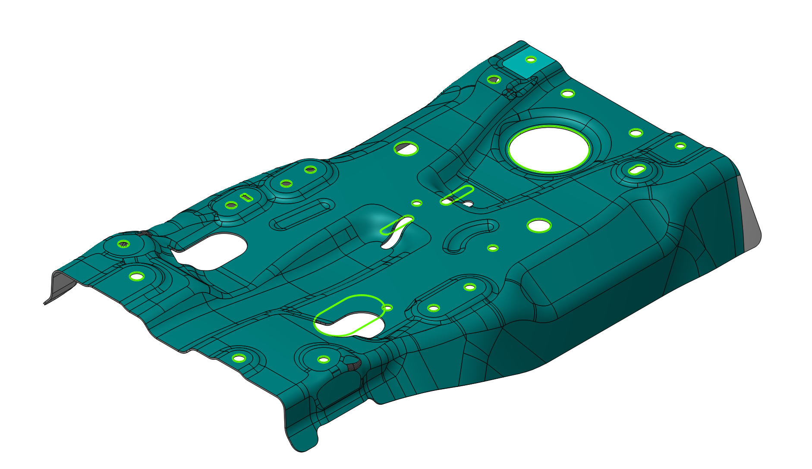

## 適用分野:

6D輪郭加工にフィーチャー認識オプションが追加されました。[詳細を見る](10129.md) この機能では、円、長方形、角丸長方形、スロット、六角形、キーホールといった形状を認識できます。この機能により、NCプログラム内の直線や円弧などの基本的な移動コマンドを、これらの高レベルな形状要素へ置き換えることができます。これにより、NCプログラムの可読性と簡潔性が向上するとともに、より高度なポストプロセッサ機能を利用できるようになります。

### フィーチャーの認識

**フィーチャーフィルター**

認識する<strong>形状要素の種類</strong>を選択します。既定値は<strong>すべて</strong>です。

**フェイス選択**

フィーチャーを認識するサーフェスを選択します。<em><strong>特定のサーフェスだけを選択するには、接線伝播を無効にする必要があります。</strong></em>

詳細を表示

選択したサーフェスは対応する色でハイライト表示されます。また、認識された形状要素もあわせてハイライト表示されます。

選択をクリックし、認識対象となるフェイスを選択します。サーフェスを1つずつ選択していくことで、選択サーフェスのリストが作成されます。リストからサーフェスを削除するには、すでに選択されているサーフェスをもう一度クリックします。

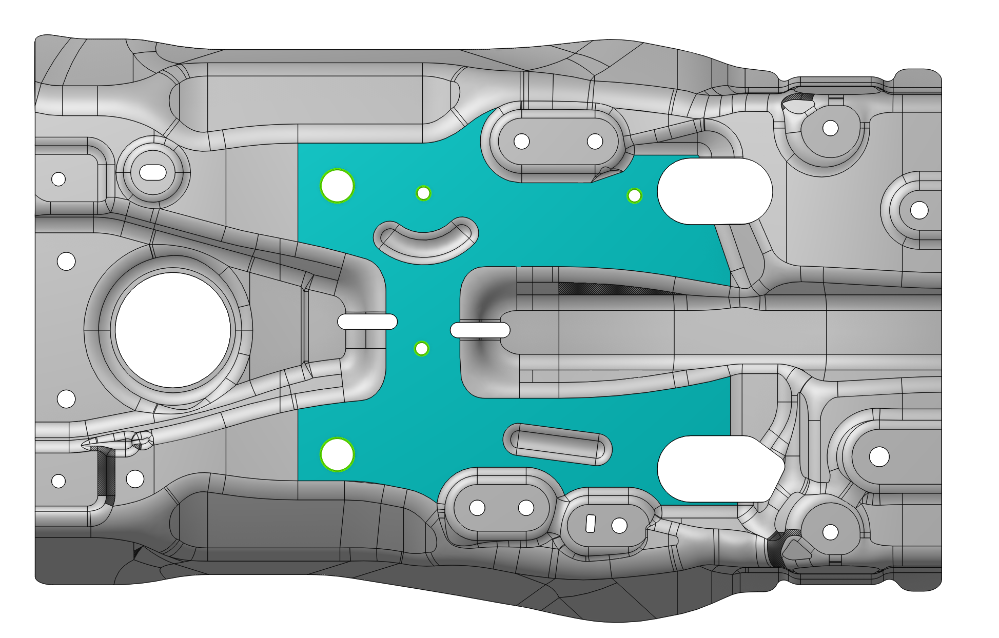 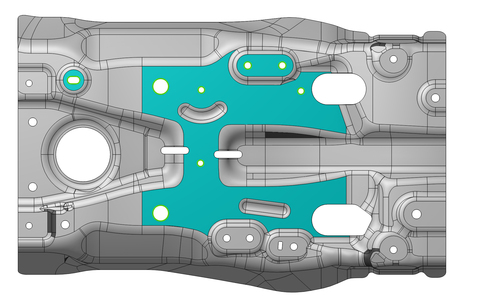

形状要素が複数のサーフェスにまたがって存在する場合は、該当するすべてのサーフェスを選択する必要があります。

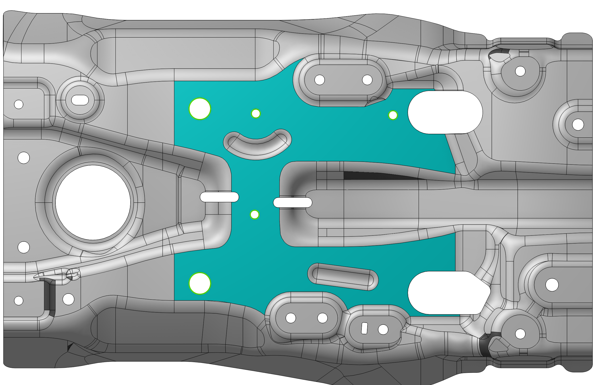 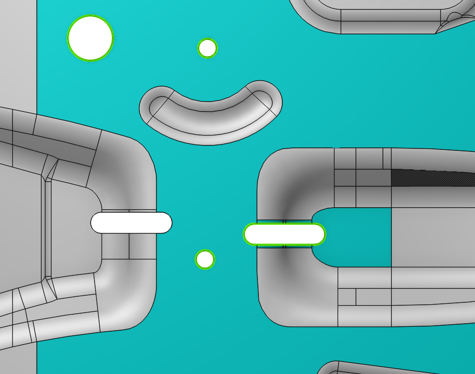

サーフェスを選択する手間を軽減するため、接線伝播オプションは初期設定で有効になっています。

**接線方向への伝播**

<strong>接線伝播</strong> この機能を有効にすると、接線でつながった滑らかな面をまとめて選択できます。

詳細を表示

初期設定では角度は <strong>0°</strong> に設定されています。この場合、この機能は滑らかな面選択オプションと同様に動作します。 [詳細を見る](10029.md)

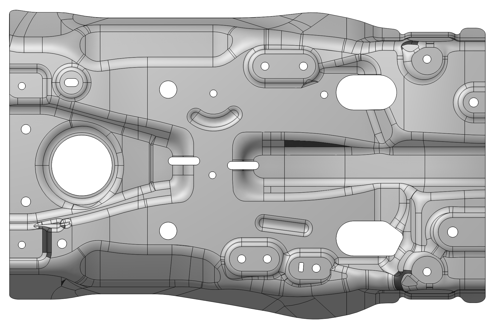 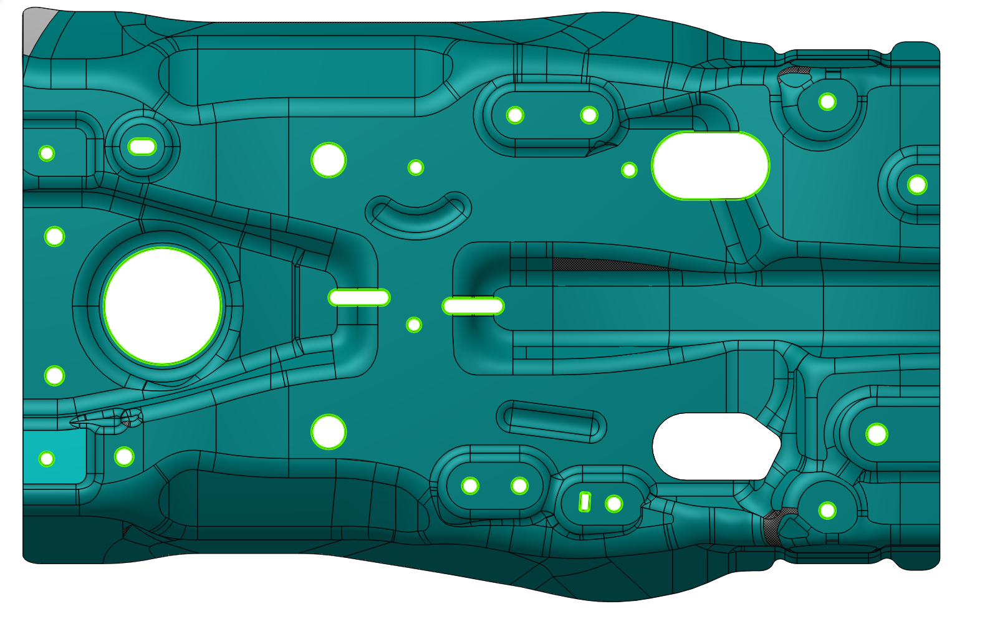

このオプションを<strong>無効</strong>にすると、システムは明示的に選択されたサーフェスの形状要素のみを認識します。

 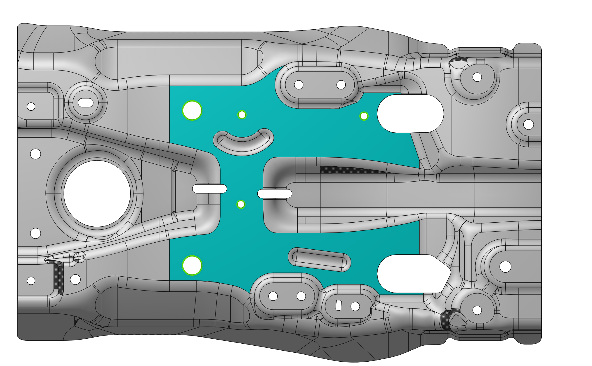

<strong>角度を大きく</strong>すると、滑らかにつながっていない面も選択対象に含めることができます。

角度 = 0

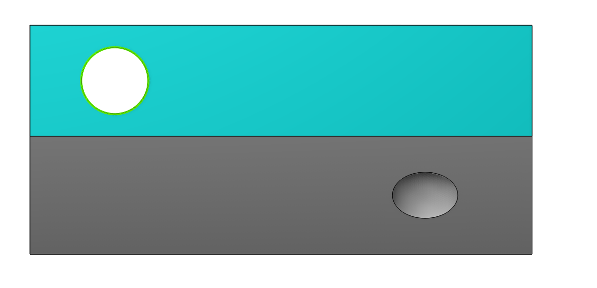

角度 = 45

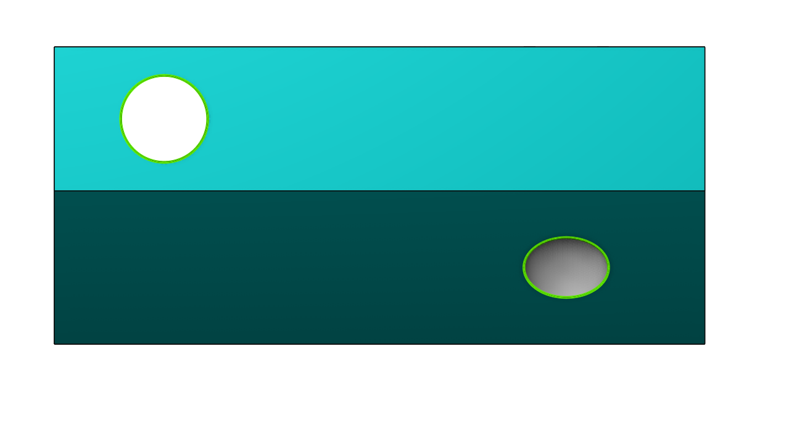

**認識されたフィーチャー**

<strong>認識された形状要素</strong>の種類を一覧表示します。

詳細を表示

<strong>円</strong> 円を定義します。<strong>円の半径</strong>は変更できます。

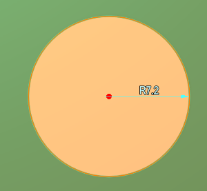

<strong>長方形</strong> 角の丸みの有無を含めた長方形を定義します。<strong>幅、長さ、</strong>およびコーナーR（<strong>角の半径</strong>）は変更できます。

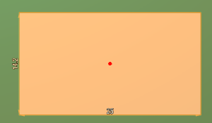 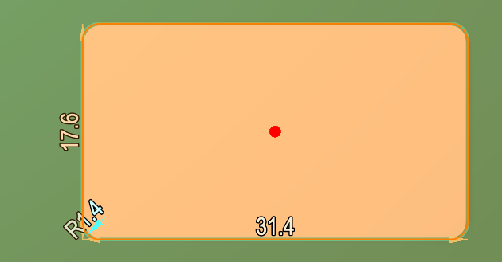

<strong>スロット。</strong> スロットを定義します。スロットの<strong>長さ</strong>と<strong>半径</strong>、および両端の半円部分の半径を変更できます。

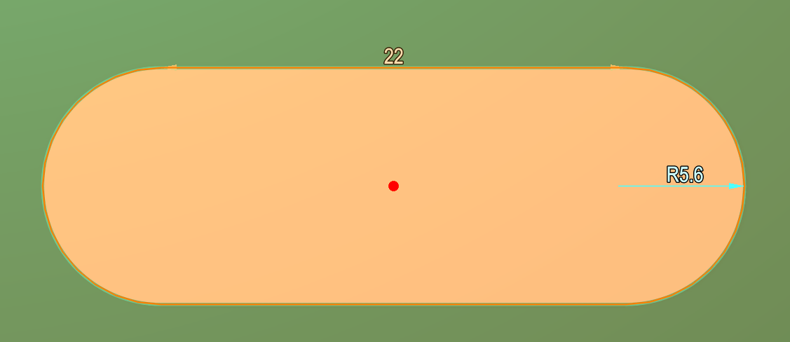

<strong>多角形</strong> 多角形 ツールは、3辺から6辺までの多角形を認識します。<strong>エッジの長さ</strong>は変更できます。

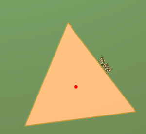 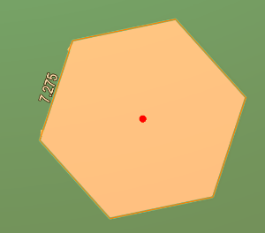

<strong>キーホール</strong> キーホール形状を定義します。円形部分およびスロット状の延長部分の寸法を変更できます。

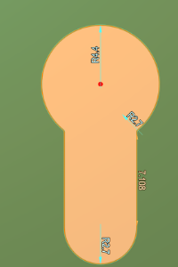

<strong>認識された要素</strong>は、寸法を変更できるだけでなく、各要素の中心にある赤い基準点をドラッグすることで、選択した平面内を移動することもできます。

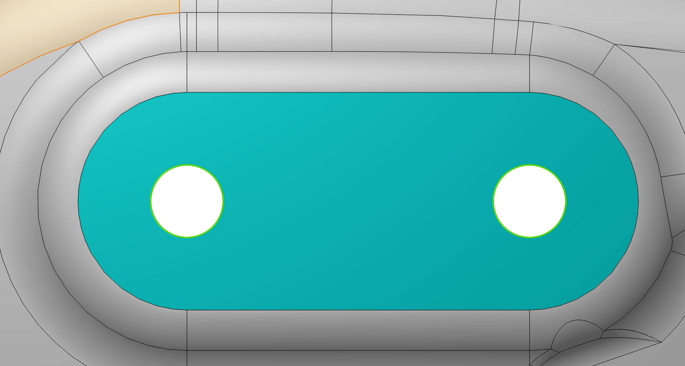 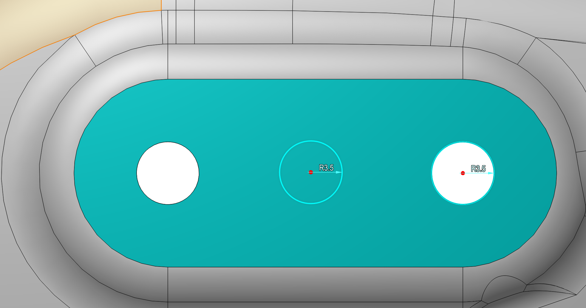

ツールパスの計算後、<strong>CLDATA</strong>には認識された<strong>形状要素</strong>に対応するコマンドが出力されます。

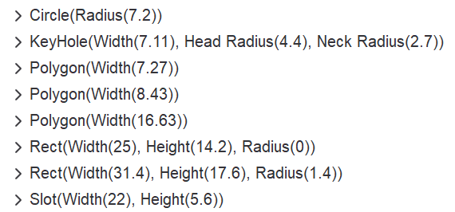

軌跡の出力方法は、<strong>パラメータ</strong>タブの<strong>フィーチャー</strong>グループで設定できます。 [詳細を見る](100112.md)
