# Valores padrão do usuário no inspetor

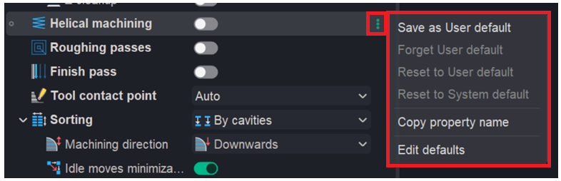

## Área de aplicação:

Essas opções de menu permitem que os usuários salvem, redefinam ou personalizem configurações de propriedades e copiem nomes de propriedades para uso em outro lugar.

<strong>Salvar como padrão do usuário</strong> - Um arquivo separado com a extensão *.usrdef é criado na pasta (%userprofile%\Documents\ENCY NB\Version 3\Operations\Defaults). Este arquivo contém os novos valores padrão para todos os parâmetros exibidos na linha do inspetor.

Clique aqui para expandir..

<em>Por exemplo, se você definir <strong>Helical machining</strong> como <strong>true</strong> em uma operação <strong>2D Contouring.</strong></em>

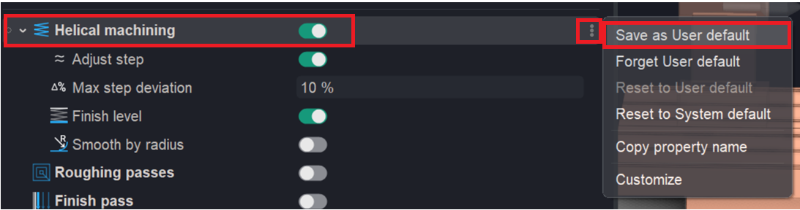

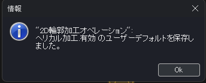

<em>A próxima operação <strong>2D contouring</strong> terá <strong>Helical machining</strong> já definido como <strong>true.</strong></em>

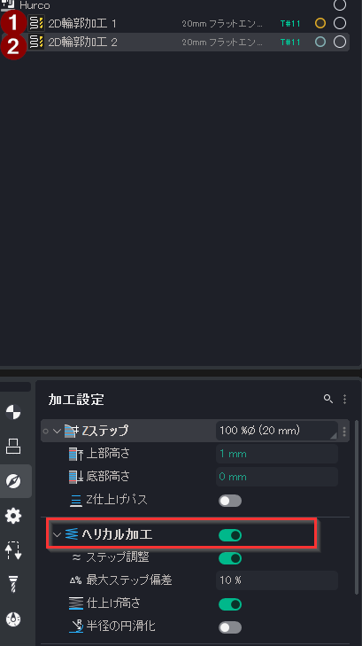

<strong>Forget user default</strong> — esquecer (excluir) o padrão do usuário. O valor de todos os parâmetros da linha atual do inspetor é removido do arquivo *.usrdef. Se nenhum padrão permanecer no arquivo, todo o arquivo será excluído. O valor atual no inspetor permanece inalterado.

Clique aqui para expandir..

<em>Por exemplo, você também pode optar por esquecer esta regra.</em>

<em>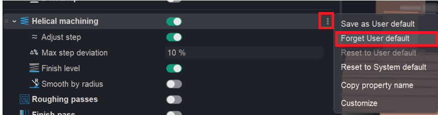</em>

<em>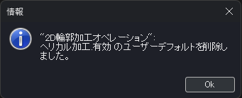</em>

<em>Nesse caso, a próxima operação será criada sem aplicar esta configuração.</em>

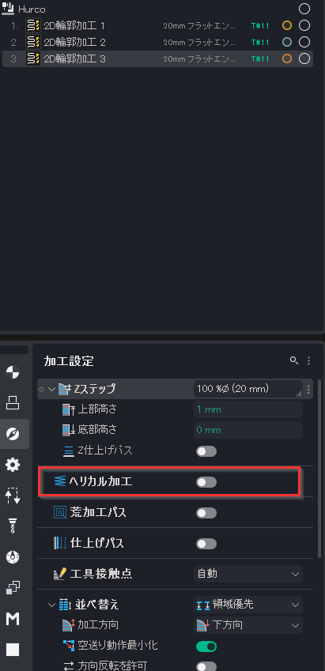

<strong>Redefinir para o padrão do usuário</strong> — redefinir para o padrão do usuário. O valor da propriedade atual é substituído pelo valor salvo nas configurações padrão do usuário.

Clique aqui para expandir..

<em>Por exemplo, se você precisar aplicar suas regras personalizadas a uma operação existente, use <strong>Redefinir para padrão do usuário</strong> — a operação adotará seus padrões salvos. <strong>Importante: isso se aplica apenas a um parâmetro específico.</strong></em>

<em>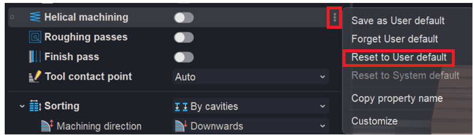</em>

<em>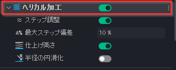</em>

<strong>Redefinir para o padrão do sistema</strong> — redefinir para o padrão do sistema. O valor da propriedade atual é substituído pelo valor salvo nas configurações padrão do sistema.

Clique aqui para expandir..

<em>Por exemplo, se você precisar restaurar as configurações padrão do sistema para uma operação existente, use <strong>Redefinir para padrão do sistema</strong> — os parâmetros da operação serão redefinidos para seus valores originais de fábrica. <strong>Importante: isso se aplica apenas a um parâmetro específico.</strong></em>

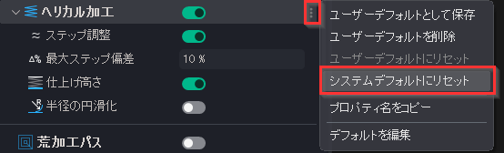

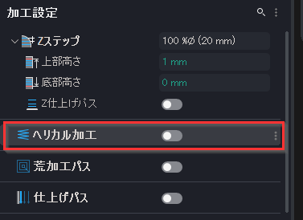

<strong>Copy property name</strong> — copiar o nome da propriedade. O nome exclusivo da propriedade é copiado para a área de transferência. Você pode usar esse nome para se referir à propriedade em expressões de outras propriedades, em pós-processadores e em extensões por meio da API. Se diversas propriedades forem exibidas na linha, seus nomes serão copiados, separados por vírgulas.

<strong>Editar padrões</strong>. Será aberta uma janela onde você poderá visualizar e editar a expressão da propriedade selecionada.

Clique aqui para expandir..

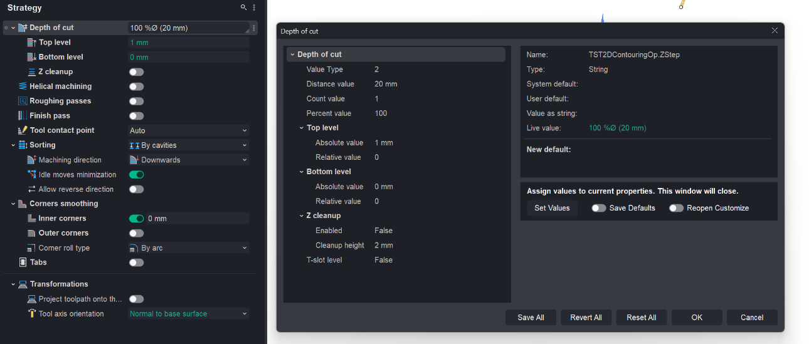

<strong>Definir valores.</strong> Quando ativado, os valores atribuídos também são gravados como o novo padrão (o campo "Novo padrão" acima), para que persistam para uso futuro - não apenas para esta instância.

<strong>Salvar padrões.</strong> Quando ativado, os valores atribuídos também são gravados como o novo padrão (o campo "Novo padrão" acima), para que persistam para uso futuro - não apenas para esta instância.

<strong>Reopen Customize.</strong> Quando ativado, após a definição dos valores a janela Customize é reaberta em vez de permanecer fechada, para que você possa continuar editando.

<strong>Salvar tudo.</strong> Salva os valores atuais de todas as propriedades como seus padrões.

<strong>Reverter tudo.</strong> Descarta suas edições não salvas e restaura todas as propriedades de volta aos seus últimos valores salvos.

<strong>Reset All.</strong> Redefine todas as propriedades para os valores padrão do sistema

<strong>OK.</strong> Confirma e aplica as alterações e fecha a caixa de diálogo.

<strong>Cancel.</strong> Fecha a caixa de diálogo sem aplicar nenhuma alteração.

A funcionalidade de <strong>exportação e importação</strong> de configurações (arquivos no formato <strong>*.usrdef</strong>) é implementada de forma semelhante ao mecanismo de trabalho com arquivos de operações do usuário. Ela pode ser acessada pela janela de criação de uma <strong>nova operação no modo Customize</strong>. [Detalhes](91.md)
