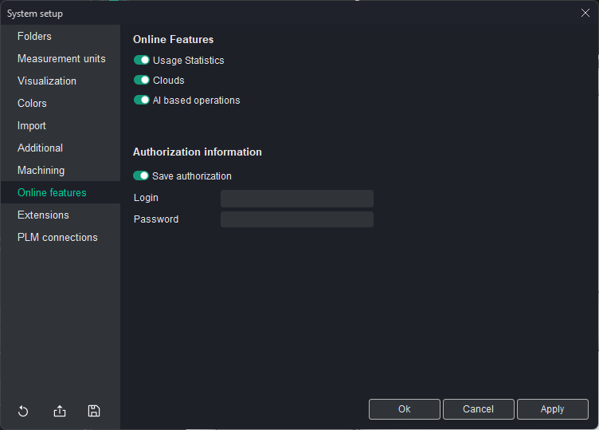

# Scheda Online features

## Funzioni online:

- L'opzione <strong>Usage Statistics</strong> (statistiche di utilizzo) consente di attivare o disattivare la raccolta di statistiche di utilizzo anonime. Quando è attivata, il sistema raccoglie dati sull'uso delle funzioni per contribuire a migliorare il software. Non vengono raccolte informazioni personali o sensibili e i dati sono utilizzati esclusivamente per migliorare l'esperienza d'uso e ottimizzare le prestazioni del sistema.
- **Clouds**. Quando questa opzione è attivata, consente l'accesso alla funzione Clouds. [Dettagli](100321.md).
- **AI-based operations** (operazioni basate sull'intelligenza artificiale). Quando questa opzione è attivata, l'utente può creare operazioni basate sull'intelligenza artificiale. Quando è disattivata, tale opzione non compare nell'elenco delle operazioni disponibili per la creazione.

## Informazioni di autorizzazione:

- **Save authorization** (salva autorizzazione). Questa opzione salva le credenziali di accesso dell'utente (login e password) nel License Manager. Quando è attivata, il sistema memorizza i dati dell'utente, offrendo un accesso più rapido ai servizi online.
- <strong>Login</strong>: questo campo serve per inserire il login dell'utente necessario per accedere alle funzioni online, come la collaborazione in cloud o le integrazioni esterne.
- <strong>Password</strong>: questo campo serve per inserire la password associata alle credenziali di accesso dell'utente, consentendo l'accesso sicuro ai servizi online del sistema.
