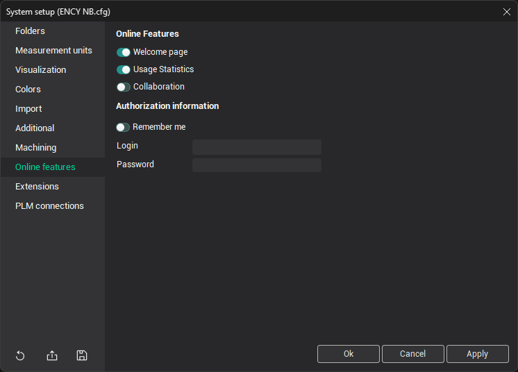

# <オンライン機能>タブ

## オンライン機能：

- <strong>`ウェルカムページ`</strong> オプションは、システム起動時のウェルカムページの表示を制御します。
- <strong>`使用統計`</strong> オプションでは、匿名の使用統計の収集を有効または無効にすることができます。この機能を有効にすると、機能の使用状況に関するデータを収集し、ソフトウェアの改善に役立てることができます。個人情報や機密情報は収集されず、データはユーザーエクスペリエンスの向上とシステムパフォーマンスの最適化にのみ使用されます。
- <strong>`コラボレーション`</strong> オプションはクラウドベースのチームワークを可能にし、ユーザーがプロジェクトを共有したり、ファイル、画像、動画に対応したチャットでコミュニケーションを取ることができます。さらに、デバイス間の互換性を維持しながら場所を問わずシームレスなリアルタイム共同作業を実現します。

## 認証情報：

- <strong>`ログイン情報を保存`</strong>：このオプションは、ユーザーのログイン認証情報（ログイン名とパスワード）を保存するため、次回以降のログイン時に再入力する必要がありません。有効にすると、システムはユーザーの詳細情報を記憶し、オンラインサービスに素早くアクセスできるようになります。
- <strong>`ログイン`</strong>: この欄は、クラウドコラボレーションや外部統合などのオンライン機能にアクセスするために必要なユーザーのログインを入力するために使用されます。
- <strong>`パスワード`</strong>：この欄は、ユーザーのログイン認証情報に関連付けられたパスワードを入力し、システムのオンラインサービスへの安全なアクセスを可能にします。
