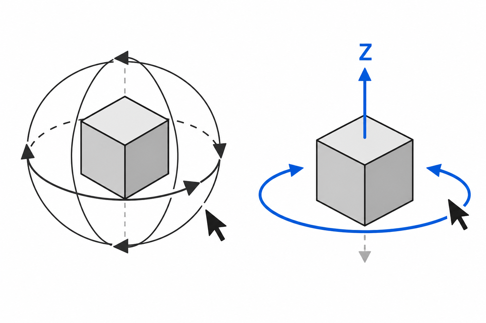
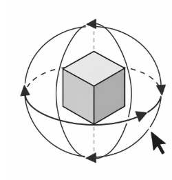
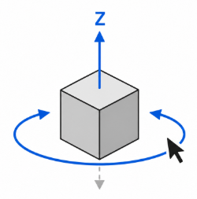

# 回転モード

## 適用分野:

回転モードは、3Dシーン内でビューポートの回転動作を制御するためのカメラナビゲーション機能です。

この機能により、自由に回転できるトラックボールモードと、回転方向を制限する「Orbit」モードを切り替えることができます。Orbitモードでは、選択したローカル軸（X、Y、またはZ）が常に画面上で垂直方向に維持されるため、視点の向きが安定し、予測しやすいカメラ操作が可能になります。

.

### トラックボール

トラックボールモードでは、ビューポートを制限なく自由に回転できます。

シーンをあらゆる方向へ自由に回転できるため、モデルを任意の角度から確認することができます。

### Orbit

Orbitモードでは、選択したローカル軸を基準としてビューポートの回転を制限します。

Orbitモードを有効にすると、次のように動作します。

- 選択したローカル軸（X、Y、またはZ）が、画面上で自動的に垂直方向に配置されます。
- ビューポートは新しい向きへ滑らかに切り替わります。
- マウスを水平方向に移動すると、選択した軸を中心にシーンが回転します。
- ナビゲーション中は、選択した軸が常に画面上で垂直方向に維持されます。

