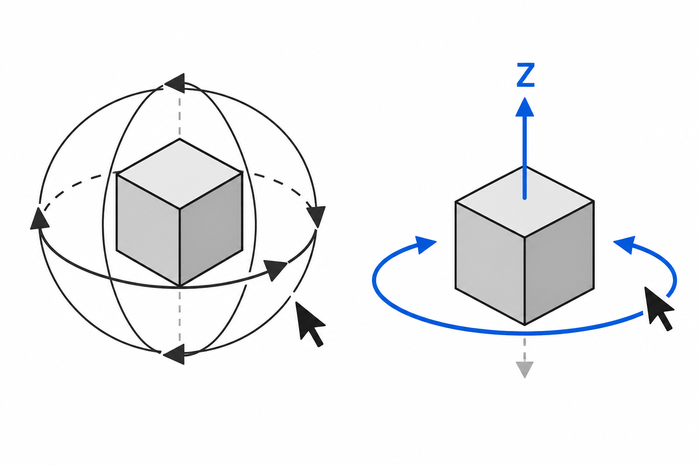
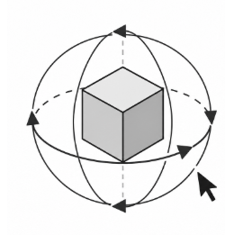
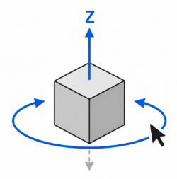

# Modo de rotação

## Área de aplicação:

O Modo de rotação foi adicionado como uma ferramenta de navegação da câmera para controlar o comportamento de rotação da janela de visualização em cenas 3D.

Ele permite alternar entre a rotação livre Trackball e a rotação restrita Orbit. No modo Orbit, um eixo local selecionado (X, Y ou Z) permanece vertical na tela, proporcionando uma orientação de câmera previsível e estável durante a navegação.

### Trackball.

O modo Trackball fornece rotação irrestrita da janela de visualização.

A cena pode ser girada livremente em todas as direções, permitindo ao usuário inspecionar o modelo de qualquer ângulo.

### Orbit.

O modo Orbit restringe a rotação da janela de visualização em torno de um eixo local selecionado.

Quando o modo Orbit é ativado:

- O eixo local selecionado (X, Y ou Z) é automaticamente alinhado verticalmente na tela.

- A visualização se ajusta suavemente à nova orientação.

- O movimento horizontal do mouse gira a cena em torno do eixo selecionado.

- O eixo selecionado permanece vertical durante toda a navegação.

