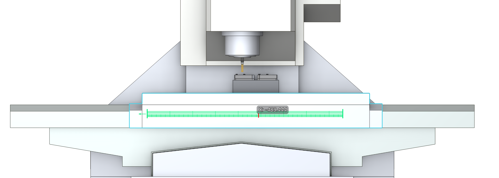

# Interaktives Lineal für Linearachsen

## Anwendungsbereich:

Das **interaktive Lineal für Linearachsen** zeigt die Position eines Maschinenknotens beim Ziehen entlang einer Linearachse in der **3D-Ansicht**. Es stellt die **aktuelle Achskoordinate** und die **Verfahrgrenzen** dar. Damit lässt sich der Knoten positionieren und seine Lage innerhalb des verfügbaren Verfahrbereichs beurteilen.

Das Lineal wird mit **Interactive Machine** verwendet, wenn die Maschinenposition direkt im Grafikfenster angepasst wird.

## Elemente des Lineals:

**Achsenskala.** Stellt den Verfahrbereich entlang der bewegten Linearachse dar.

**Aktuelle Achskoordinate.** Zeigt neben der Positionsmarkierung den Achsnamen und die aktuelle Koordinate. In der Abbildung bezeichnet **X: -489,444** die Achse und ihre Position.

**Verfahrgrenzen.** Kennzeichnen die Enden des Verfahrbereichs, damit die aktuelle Position mit den Grenzen verglichen werden kann.

*Das Linearachsenlineal wird angezeigt, während ein Maschinenknoten entlang der X-Achse verschoben wird.*
