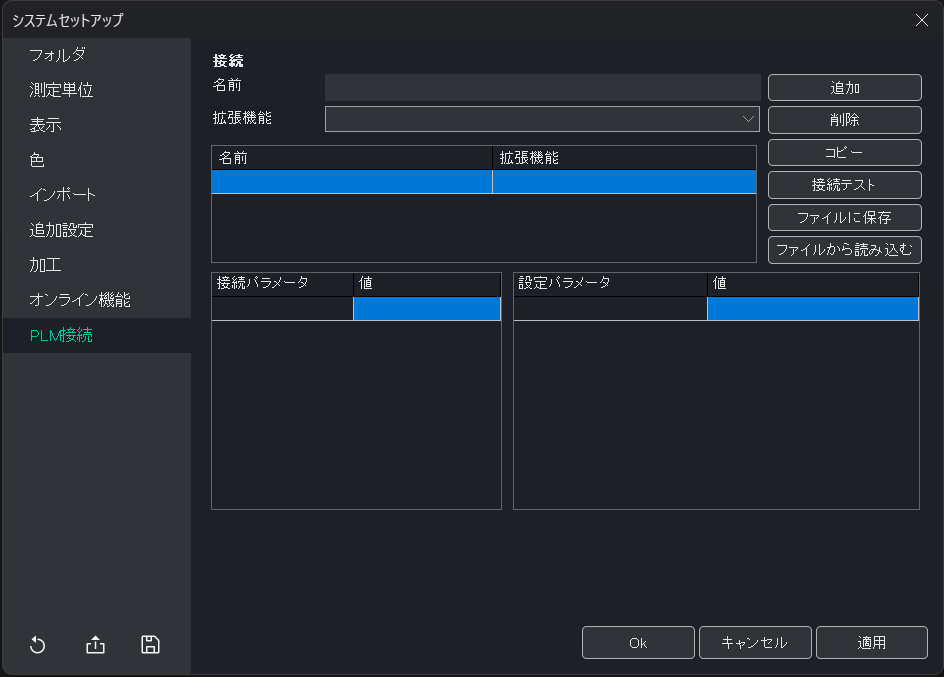

# Registerkarte PLM-Verbindungen

Auf dieser Registerkarte werden Verbindungen zu verschiedenen PLM-Systemen konfiguriert. Die Konfiguration ist unter [Einrichtung von PLM-Verbindungen](102017.md) beschrieben.

Weitere Einzelheiten finden Sie in der Dokumentation des Integrationsmoduls für das jeweilige PLM-System.

