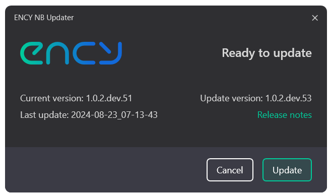
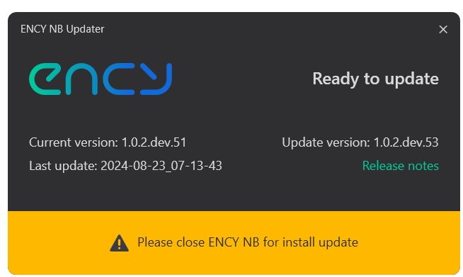

# Aggiornamento

Il sistema CAM verifica la disponibilità di aggiornamenti a ogni avvio. Il sistema scarica automaticamente tutti i file necessari e li controlla. Non è necessario tenere aperto il sistema CAM: la verifica degli aggiornamenti in background prosegue anche dopo la chiusura del sistema CAM.

Quando il sistema di aggiornamento trova e scarica con successo i moduli, viene visualizzata una richiesta di aggiornamento:

Premere il pulsante **Update** (aggiorna) per avviare il processo di aggiornamento.

Processo di aggiornamento

Il processo di aggiornamento del sistema CAM comprende tre fasi:

- **Close CAM system** (chiusura del sistema CAM) — il sistema attende che l'utente salvi tutti i progetti e chiuda manualmente il sistema CAM. L'avvio del sistema CAM è bloccato durante l'aggiornamento. In questa fase è possibile annullare il processo di aggiornamento chiudendo la finestra di aggiornamento.
- **Updating** (aggiornamento) — il sistema avvia l'aggiornamento. Il sistema CAM può richiedere un account amministrativo per completare questa fase.
- **Finish** (fine) — il sistema elimina tutti i dati temporanei utilizzati per l'aggiornamento.

Al termine di queste fasi, la finestra di aggiornamento viene chiusa e il sistema CAM viene avviato automaticamente.
