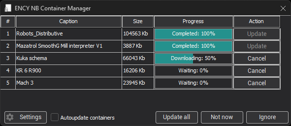
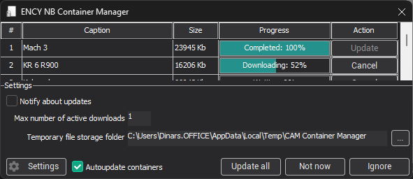
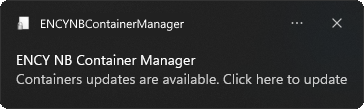
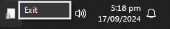

# コンテナマネージャ

CAMシステムにコンテナマネージャが追加されました。該当するコンテナのライセンスが有効である場合、コンテナファイル（.stfc）を自動的にダウンロードおよび更新します。

システムは、CAM システムの起動時およびライセンスマネージャによるライセンスインストール時に、未インストールのコンテナおよびコンテナファイルの更新をチェックします。

メッセージやトレイのアイコンをクリックすると、ダウンロードやアップデートが可能なコンテナの一覧を表示するウィンドウが開きます。

- <strong>Update</strong> 選択したコンテナのダウンロードおよび更新処理を開始します。
- <strong>Update all</strong> 一覧にあるすべてのコンテナのダウンロードおよび更新処理を開始します。
- <strong>Not now</strong> ダウンロード/更新処理をキャンセルし、コンテナ マネージャをトレイに最小化します。次回の更新を促す通知が表示されます。
- <strong>Ignore</strong> ボタンは、ダウンロード/更新処理をキャンセルし、コンテナ マネージャをトレイに最小化します。また、コンテナマネージャの設定パネルで <strong>Notify about updates</strong> オプションが有効になるまで、システムは更新通知を表示しなくなります。
- <strong>コンテナの自動更新</strong> オプションは、ユーザー通知なしでコンテナのダウンロード/更新が自動的に行われます。
- <strong>Settings</strong> コンテナマネージャの設定パネルを表示または非表示にします。

- <strong>Notify about updates</strong> コンテナの更新に関する通知の有効/無効を切り替えます。なお <strong>Ignore</strong> ボタンをクリックすると、設定は無効になります。
- <strong>Max number of active downloads</strong> 同時に実行するコンテナのダウンロード数を設定します。インターネット接続が遅い場合は、値を"1"に設定することが推奨されます。
- <strong>Temporary file storage folder</strong> 欄は、ダウンロードしたコンテナファイルを一時的に保存するディレクトリを設定します。

ダウンロードが開始されると、コンテナファイルは設定パネルで指定された一時ディレクトリに保存されます。ダウンロードが完了すると、コンテナマネージャはCAMシステムが終了するのを待機し、その後、ダウンロード済みのファイルをシステムのコンテナストレージディレクトリに移動します。

処理が終了すると、CAMシステムコンテナマネージャは自動的に終了します。

コンテナマネージャを強制終了するには、トレイ アイコンを右クリックし、コンテキスト メニューから <strong>Exit</strong> を選択します。

コンテナマネージャを強制終了すると、すべてのアクティブなダウンロードが中断され、すでにダウンロード済みのコンテナも、CAMシステムのコンテナストレージディレクトリへは移動されません。次回システム起動時には、更新が中断されたコンテナは自動的に再ダウンロードされます。
