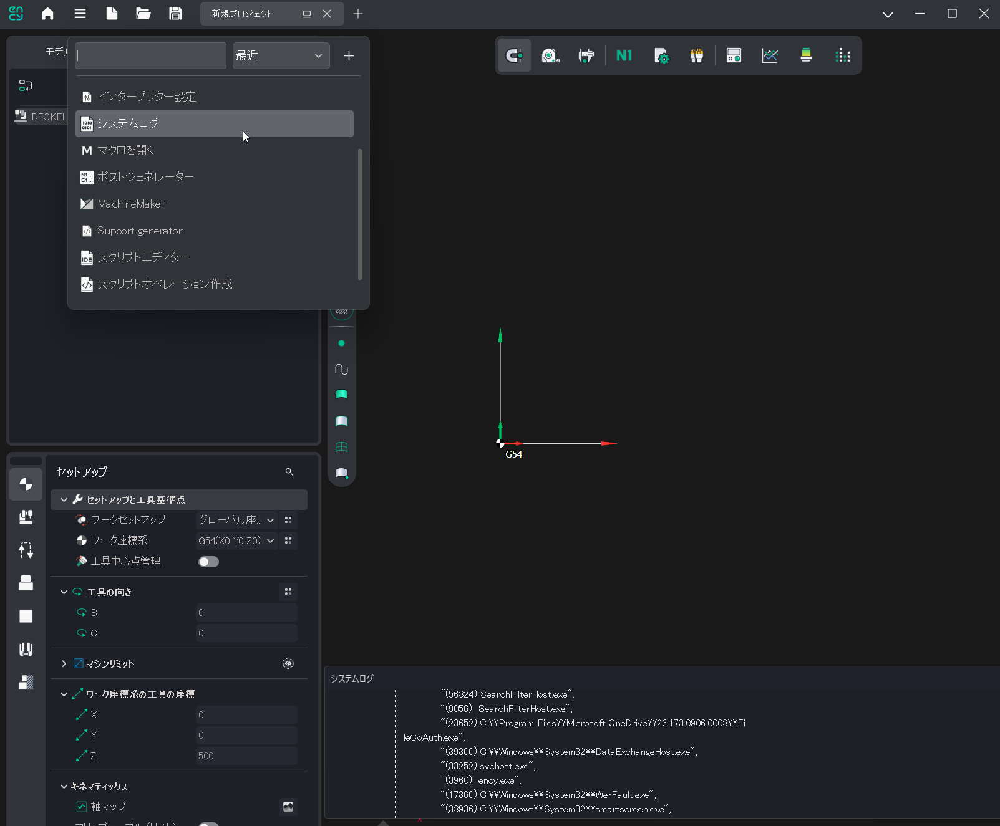

# システムログ

このシステムは、アプリケーションの起動以降に発生した主なイベントのリストを表示することができます。

イベント（過去の操作）は別ウィンドウに表示され、 <strong>`ユーティリティ設定``システムログ`</strong> メニューからアクセスできます。

各イベントには、発生時刻と説明が含まれています。説明が長すぎて1行に収まらない場合は、行の先頭に「展開」ボタンが表示されます。エラーは赤、警告は黄、正常な動作は白と、イベントの種類によって色分けされます。

このウィンドウは、イベントの詳細を追跡し、問題の原因を特定できるため、トラブルシューティングに特に役立ちます。
