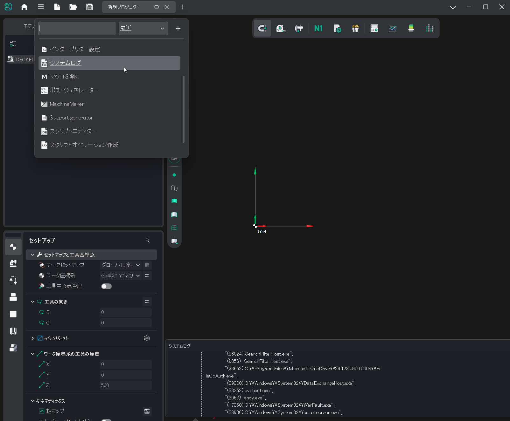

# Registros do sistema

O sistema permite consultar os principais eventos ocorridos desde a inicialização do aplicativo.

Os eventos são exibidos em uma janela separada, acessível pelo menu **Utilities > System logs**.

Cada evento apresenta o horário da ocorrência e uma descrição. Se a descrição não couber em uma linha, um botão "Expand" será exibido no início da linha. As cores identificam o tipo de evento: vermelho para erros, amarelo para avisos e branco para ocorrências normais.

Essa janela pode ser especialmente útil no diagnóstico de problemas, pois permite acompanhar os detalhes dos eventos e, possivelmente, identificar a causa dos problemas.
