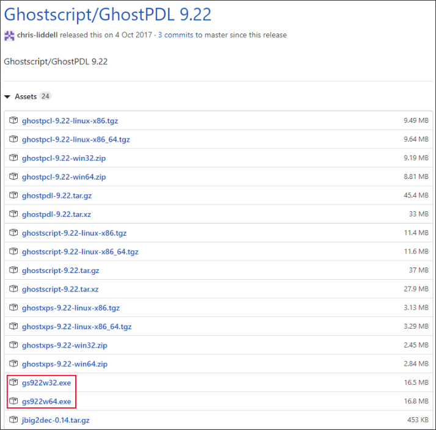
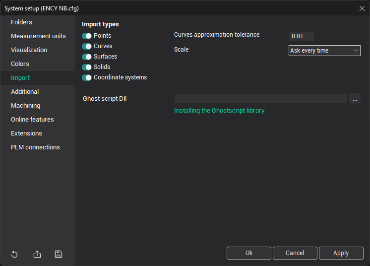

# Installazione della libreria GhostScript

Il software Ghostscript è necessario per importare file PostScript. Questa libreria è stata sviluppata da [Artifex Software, Inc.](https://www.ghostscript.com/index.html) e non è inclusa nella distribuzione del sistema CAM a causa di restrizioni di licenza. È tuttavia possibile scaricarla e installarla per uso personale.

Il sistema CAM supporta la libreria Ghostscript in versione non precedente alla 9.22.

<strong>[Scaricare Ghostscript 9.22](https://github.com/ArtifexSoftware/ghostpdl-downloads/releases/tag/gs922)</strong>

Si apre la finestra del repository GitHub: selezionare la versione compatibile per Windows (64 bit):

<em><strong>Nota:</strong> è necessario selezionare Ghostscript a 64 bit.</em>

Dopo l'installazione è necessario specificare il percorso della libreria: gsdll32.dll o gsdll64.dll (a 32 o 64 bit). Si trova nella cartella in cui è stato installato il software Ghostscript, nella sottocartella bin. Questa operazione può essere eseguita nella scheda <strong>System setup</strong> (impostazioni di sistema), voce <strong>Import</strong> (importazione):

