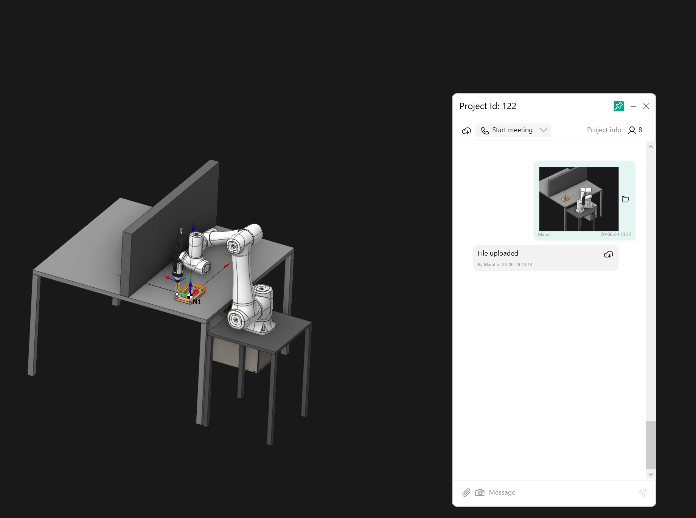
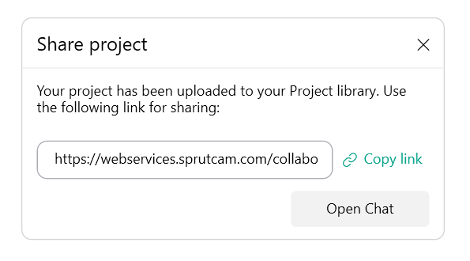
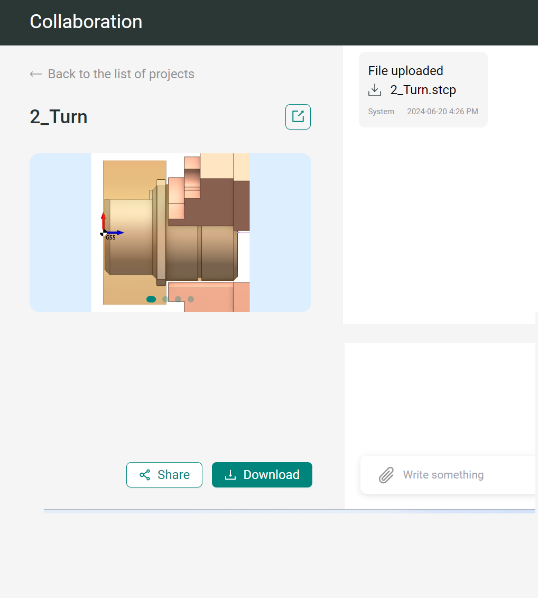
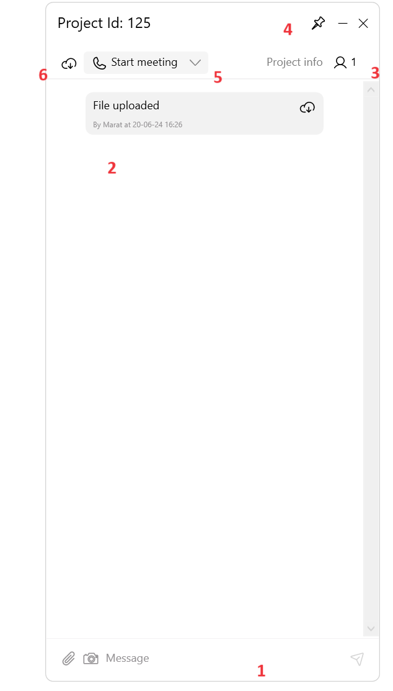
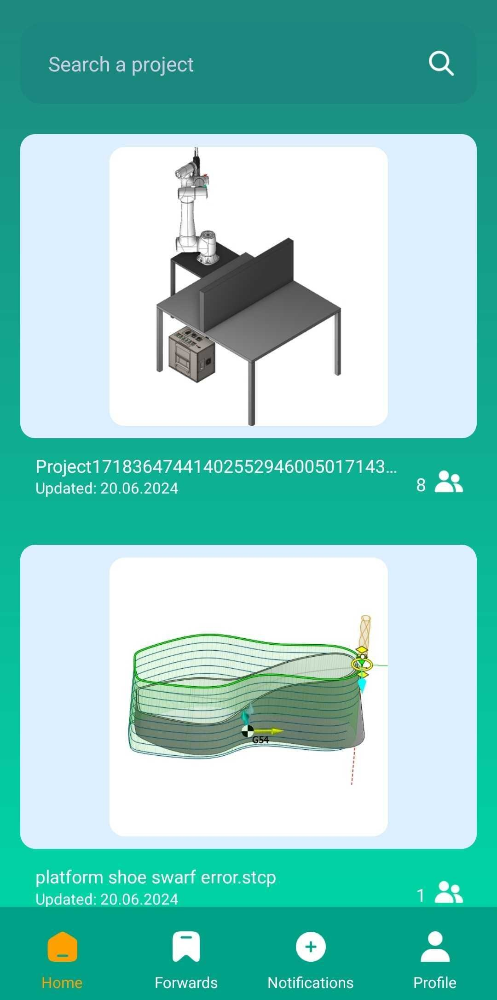

# Trabalho em equipe na nuvem

## Área de aplicação:

Trabalho em equipe na nuvem, com destaque para o chat, o acesso compartilhado a projetos e a compatibilidade entre dispositivos. Imagine um espaço de trabalho em que a distância é irrelevante. Em que equipes, geograficamente dispersas ou simplesmente em salas diferentes, podem colaborar em projetos sem dificuldade, compartilhar ideias em tempo real e permanecer conectadas onde quer que estejam. Esse é o potencial da colaboração baseada na nuvem.

## Particularidades do trabalho em equipe na nuvem:

<strong>1. Compartilhe seu projeto.</strong> Ao abrir um projeto, você verá uma marca no nome dele que permite compartilhá-lo com outra pessoa.

Será exibida uma janela para compartilhar o projeto. Envie o link para sua equipe.

Esse link concede à sua equipe acesso a um arquivo para download em nosso site. O arquivo contém informações sobre a tecnologia de usinagem, e a equipe pode acessá-lo após a autenticação.

<strong>2. Discuta questões, compartilhe capturas de tela e vídeos e trabalhe em conjunto para concluir as tarefas.</strong>

O sistema permite compartilhar dados por meio do chat. Conheça os recursos disponíveis para otimizar seu fluxo de trabalho:

1. O chat permite compartilhar uma grande variedade de dados, de arquivos de projeto a imagens e vídeos.
2. O histórico do chat permite consultar facilmente discussões anteriores e manter-se informado sobre conversas passadas.
3. É possível ver quem tem acesso à sua colaboração.
4. A janela do chat pode ser fixada para permanecer visível sobre todas as outras janelas.
5. É possível fazer uma chamada para seu interlocutor.
6. Salvar o projeto na nuvem permite que sua equipe acesse e visualize os resultados intermediários. Essa ação é executada automaticamente ao salvar o projeto no sistema CAM.

<strong>3. Mantenha a comunicação com outras pessoas, independentemente da localização, por meio deste aplicativo.</strong>

