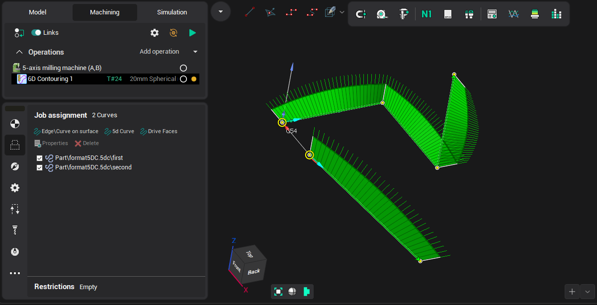
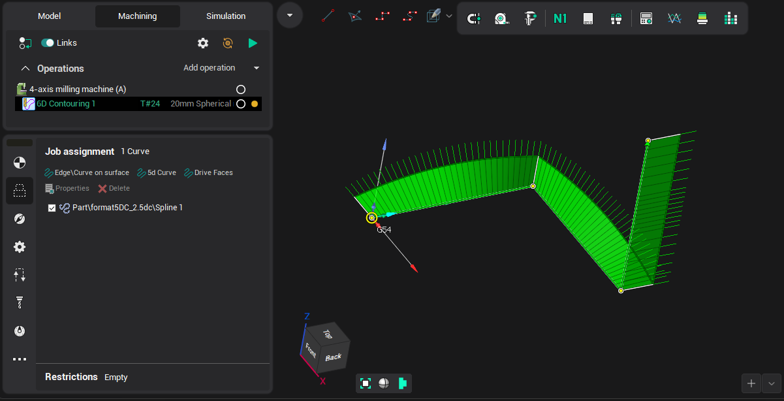

# Importação de objetos de arquivos 5DC

O formato `5DC` permite carregar splines como um conjunto de pontos (xyzijk). Os principais recursos:

- é suportado apenas o formato de texto com codificação UTF-8
- permite conter várias splines: como separador, use o símbolo ";" (ponto e vírgula) em uma nova linha. Após o símbolo, você pode especificar o nome da curva.
- o número mínimo de pontos de spline (linhas) não deve ser inferior a 2
- a primeira linha do arquivo, em vez de pontos, pode conter configurações

Se a primeira linha do arquivo não contiver nenhuma configuração, então para cada linha incluindo a primeira:

- os números de coordenadas são separados por um espaço
- o ponto é fornecido como 6 números: "X Y Z NX NY NZ", em que (X,Y,Z) - coordenadas de um ponto, (NX,NY,NZ) - vetor normal

Se a primeira linha do arquivo contiver as configurações, então para cada linha, exceto a primeira:

- os números das coordenadas são separados pelo separador especificado na linha de configurações
- o ponto é representado como vários números, de acordo com o formato especificado na linha de configurações

Se a linha de configurações for definida, ela deverá conter três parâmetros obrigatórios e poderá conter seis parâmetros opcionais. Os parâmetros devem ser separados por um espaço.

Parâmetros obrigatórios:

- Formato numérico do ponto:

|   | Formato | Descrição | Número de pontos em uma linha |
|---|---|---|---|
| 1 | tffNormalVector | Coordenadas do ponto e normal | 6 |
| 2 | tffQuaternion | Coordenadas do ponto e quatérnio X Y Z W | 7 |
| 3 | tffEulerXYZ | Coordenadas do ponto e ângulos de Euler Rx Ry Rz com rotações em torno dos eixos móveis | 6 |
| 4 | tffEulerXZY | Coordenadas do ponto e ângulos de Euler Rx Rz Ry com rotações em torno dos eixos móveis | 6 |
| 5 | tffEulerYXZ | Coordenadas do ponto e ângulos de Euler Ry Rx Rz com rotações em torno dos eixos móveis | 6 |
| 6 | tffEulerYZX | Coordenadas do ponto e ângulos de Euler Ry Rz Rx com rotações em torno dos eixos móveis | 6 |
| 7 | tffEulerZXY | Coordenadas do ponto e ângulos de Euler Rz Rx Ry com rotações em torno dos eixos móveis | 6 |
| 8 | tffEulerZYX | Coordenadas do ponto e ângulos de Euler Rz Ry Rx com rotações em torno dos eixos móveis | 6 |
| 9 | tffEulerXYX | Coordenadas do ponto e ângulos de Euler Rx Ry Rx com rotações em torno dos eixos móveis | 6 |
| 10 | tffEulerXZX | Coordenadas do ponto e ângulos de Euler Rx Rz Rx com rotações em torno dos eixos móveis | 6 |
| 11 | tffEulerYXY | Coordenadas do ponto e ângulos de Euler Ry Rx Ry com rotações em torno dos eixos móveis | 6 |
| 12 | tffEulerYZY | Coordenadas do ponto e ângulos de Euler Ry Rz Ry com rotações em torno dos eixos móveis | 6 |
| 13 | tffEulerZXZ | Coordenadas do ponto e ângulos de Euler Rz Rx Rz com rotações em torno dos eixos móveis | 6 |
| 14 | tffEulerZYZ | Coordenadas do ponto e ângulos de Euler Rz Ry Rz com rotações em torno dos eixos móveis | 6 |
| 15 | tffFixedABC | Coordenadas do ponto e ângulos de Euler Rx Ry Rz sem rotações em torno dos eixos móveis | 6 |
| 16 | tffFixedXZY | Coordenadas do ponto e ângulos de Euler Rx Rz Ry sem rotações em torno dos eixos móveis | 6 |
| 17 | tffFixedYXZ | Coordenadas do ponto e ângulos de Euler Ry Rx Rz sem rotações em torno dos eixos móveis | 6 |
| 18 | tffFixedYZX | Coordenadas do ponto e ângulos de Euler Ry Rz Rx sem rotações em torno dos eixos móveis | 6 |
| 19 | tffFixedZXY | Coordenadas do ponto e ângulos de Euler Rz Rx Ry sem rotações em torno dos eixos móveis | 6 |
| 20 | tffFixedZYX | Coordenadas do ponto e ângulos de Euler Rz Ry Rx sem rotações em torno dos eixos móveis | 6 |
| 21 | tffFixedXYX | Coordenadas do ponto e ângulos de Euler Rx Ry Rx sem rotações em torno dos eixos móveis | 6 |
| 22 | tffFixedXZX | Coordenadas do ponto e ângulos de Euler Rx Rz Rx sem rotações em torno dos eixos móveis | 6 |
| 23 | tffFixedYXY | Coordenadas do ponto e ângulos de Euler Ry Rx Ry sem rotações em torno dos eixos móveis | 6 |
| 24 | tffFixedYZY | Coordenadas do ponto e ângulos de Euler Ry Rz Ry sem rotações em torno dos eixos móveis | 6 |
| 25 | tffFixedZXZ | Coordenadas do ponto e ângulos de Euler Rz Rx Rz sem rotações em torno dos eixos móveis | 6 |
| 26 | tffFixedZYZ | Coordenadas do ponto e ângulos de Euler Rz Ry Rz sem rotações em torno dos eixos móveis | 6 |
| 27 | tffTwoAngAB | Coordenadas do ponto e dois ângulos AB | 5 |
| 28 | tffTwoAngAC | Coordenadas do ponto e dois ângulos AC | 5 |
| 29 | tffTwoAngBA | Coordenadas do ponto e dois ângulos BA | 5 |
| 30 | tffTwoAngBC | Coordenadas do ponto e dois ângulos BC | 5 |
| 31 | tffAxisAngleRad | Coordenadas do ponto e ângulo do eixo em radianos | 6 |
| 32 | tffAxisAngleDeg | Coordenadas do ponto e ângulo do eixo em graus | 6 |

- Os ângulos são especificados em graus: Verdadeiro (graus)/Falso (radianos). Aplica-se aos formatos dos itens 3-30.
- Separador: sempre um caractere.

Parâmetros opcionais (transformação adicional):

- Transformação ao longo do eixo X. X=N, em que N é o valor de deslocamento
- Transformação ao longo do eixo Y. Y=N, em que N é o valor de deslocamento
- Transformação ao longo do eixo Z. Z=N, em que N é o valor de deslocamento
- Rotação para um ângulo A. A=N, onde N - valor do ângulo de rotação
- Rotação para um ângulo B. B=N, onde N - valor do ângulo de rotação
- Rotação para um ângulo C. C=N, onde N - valor do ângulo de rotação

Exemplo de um arquivo que não contém linha de configurações:

```
                    format5DC.5dc
; first
0.000000 0.000000 0.000000 -1.000000 0.000000 0.000000
0.000000 50.000000 0.000000 0.000000 0.000000 1.000000
50.000000 50.000000 0.000000 0.000000 1.000000 0.000000
50.000000 50.000000 50.000000 1.000000 0.000000 0.000000
; second
25.000000 0.000000 0.000000 0.000000 0.000000 1.000000
50.000000 50.000000 -50.000000 0.000000 1.000000 0.000000
```

O resultado da adição de curvas em <strong>Job assignment</strong> pelo botão  na operação [5D Contouring](10129.md) é mostrado na imagem a seguir:



Arquivo de exemplo, com linha de configurações:

```
                    format5DC_2.5dc
tffEulerXYZ true , A=0.00 B=0.00 C=0.00
0.000,0.000,0.000,0.000,-90.000,0.000
0.000,50.000,0.000,0.000,0.000,90.000
50.000,50.000,0.000,-90.000,0,0.000
50.000,50.000,50.000,-90.000,0,0.000
```

O resultado da adição dessa curva em <strong>Job assignment</strong> pelo botão  na operação [5D Contouring](10129.md) é mostrado na imagem a seguir:


