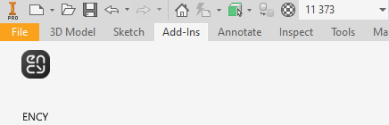
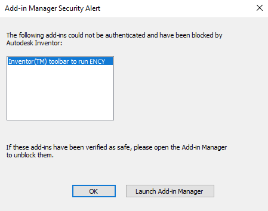
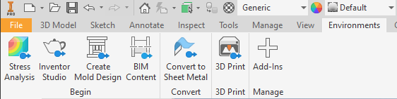
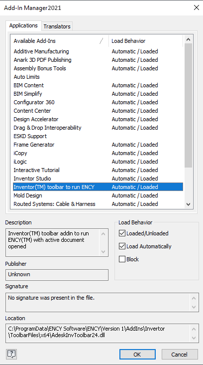

# Autodesk Inventor™ ツールバー＆インポートアドイン

このツールバーを使用すると、<strong>Autodesk Inventor Professional™</strong> から図形データをエクスポートすることができます。 [詳細を見る](10039.md)

このアドインを使用すると、<strong>Autodesk Inventor Professional™</strong> のプロジェクトファイルをインポートすることができます。

サポートされているファイル拡張子： IAM, IDW, IPT, IPN, IDE, PRT, ASM, SAT, STE, STEP, DWG, DXF, IGES, IGS.

この機能を使用するには、必要なアプリケーション（<strong>Autodesk Inventor Professional™</strong>）がコンピュータにインストールされている必要があります。

<strong>Autodesk Inventor Professional™2021</strong> では、ツールバーのインストールに問題がある場合があります。

起動時に以下のウィンドウが表示された場合：

使用する場合は、 <strong>Autodesk Inventor Professional™2021</strong>でツールバーを手動で有効にする必要があります。これを行うには、このウィンドウでアドインマネージャーを起動するか、リボンパネルのボタンで起動します。

開いたウィンドウで、CAMシステムツールバーを見つけ、以下のスクリーンショットのようにパラメーターを設定する必要があります。

次に、リボンパネルにCAMシステムツールバーが表示されます。
