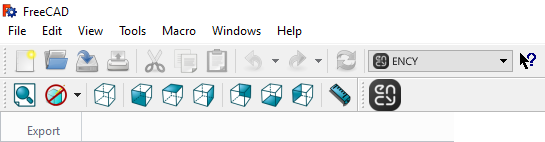

# FreeCAD™ ツールバー＆インポートアドイン

このツールバーを使用すると、<strong>FreeCAD™</strong> から図形データをエクスポートすることができます。[詳細を見る](10039.md)

このアドインを使用すると、<strong>FreeCAD™</strong> のプロジェクトファイルをインポートすることができます。

サポートされているファイル拡張子： FCSTD, BREP, BRP, DAT, SVG, SVGZ, UNV, MED, BDF, IFC, IV, AST, BMS, OBJ, OFF, PLY, OCA, GCAD, CSG, ASC, POV, INC.

> このオプションを正しく動作させるには、必要なアプリケーション<strong>（FreeCAD™）</strong>をコンピュータにインストールする必要があります。
