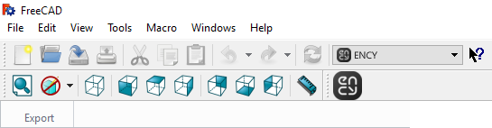

# FreeCAD™: Symbolleiste und Import-Add-in

Mit der Symbolleiste können Sie geometrische Daten aus FreeCAD™ exportieren. Die unterstützten CAD-Versionen sind in der Übersicht aufgeführt. [Details](10039.md)

Mit dem Add-In können Sie <strong>FreeCAD™</strong>-Projektdateien importieren.

Unterstützte Dateierweiterungen: FCSTD, BREP, BRP, DAT, SVG, SVGZ, UNV, MED, BDF, IFC, IV, AST, BMS, OBJ, OFF, PLY, OCA, GCAD, CSG, ASC, POV, INC. Damit diese Option funktioniert, muss die erforderliche Anwendung (FreeCAD™) auf Ihrem Computer installiert sein.
