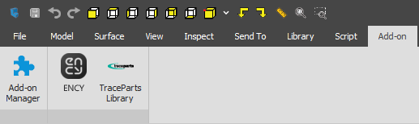

# Alibre Design™ ツールバー＆インポートアドイン

このツールバーは、Alibre Design™から形状データをエクスポートできます。 [詳細を見る](10039.md)

このアドインを使用すると、<strong>Alibre</strong> <strong>Design™</strong> のプロジェクトファイルをインポートすることができます。

サポートされているファイル拡張子： AD_PRT, AD_ASM, AD_SMP.

> このオプションを正しく動作させるには、必要なアプリケーション<strong>（Alibre Design™）</strong>をコンピュータにインストールする必要があります。
