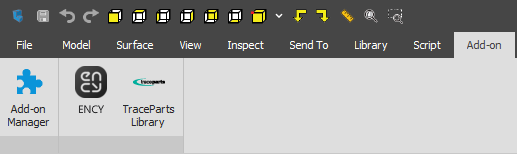

# Alibre Design™ ツールバー＆インポートアドイン

このツールバーは、Alibre Design™から形状データをエクスポートできます。 [詳細を見る](10039.md)

このアドインを使用すると、<strong>Alibre</strong> <strong>Design™</strong> のプロジェクトファイルをインポートすることができます。

サポートされているファイル拡張子：AD_PRT、AD_ASM、AD_SMP。 このオプションを使用するには、必要なアプリケーション（Alibre Design™）がコンピューターにインストールされている必要があります。
