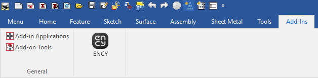
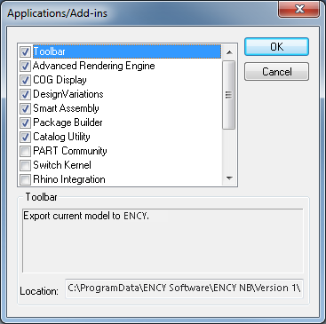

# Barra de ferramentas do IronCAD™

A barra de ferramentas permite exportar dados geométricos do IronCAD™. Consulte as versões suportadas do sistema CAD em [Detalhes](10039.md).

Após a instalação, a barra de ferramentas pode não aparecer no IronCAD™. Nesse caso, clique em

na caixa de diálogo para ativá-la:

Extensões suportadas: ICS, IC3D, ICSW, ICD, EXB. O IronCAD™ deve estar instalado no computador para que o recurso funcione.
