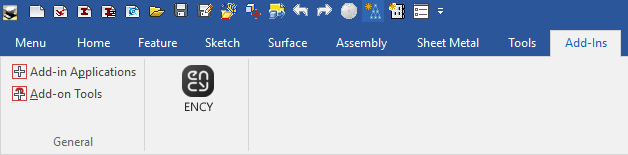
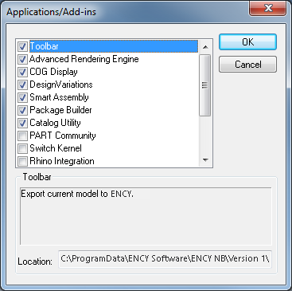

# IronCAD™ ツールバー

このツールバーは、 <strong>IronCAD™</strong>から形状データをエクスポートできます。 [詳細を見る](10039.md)

インストール後、ツールバーが <strong>IronCAD™</strong> に表示されない場合があります。その場合は、ダイアログボックス内の

ボタンを押して有効化してください。

サポートされているファイル拡張子：ICS, IC3D, ICSW, ICD, EXB.

> このオプションを使用するには、必要なアプリケーション <strong>（IronCAD™）</strong>を コンピュータにインストールする必要があります。
