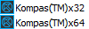

# KOMPAS™ ツールバー＆インポートアドイン

このツールバーは、<strong>Kompas™</strong> または <strong>Kompas Home™</strong>から形状データをエクスポートできます。

対象のCADシステムには、x32版とx64版の2種類があります。

> <strong>Kompas V18</strong>以降のバージョンでは、<strong>デモモード</strong>では動作しません。

アドインは、<strong>Kompas™</strong> または <strong>Kompas Home™</strong> のプロジェクトファイルをインポートすることができます。

対応ファイル拡張子：A3D、M3D、CDW、FRW。

> このオプションを正しく動作させるには、必要なアプリケーション（<strong>Kompas™</strong> または <strong>Kompas Home™</strong>）をコンピュータにインストールする必要があります。

関連付け

<strong>Kompas™</strong>でモデルを再構築する際に、ボディ全体を変更する操作（移動、スケーリングなど）を使用すると、関連付けは機能しなくなります。これらの操作はユニークインデックスを完全にリセットしてしまうため、再割り当てが必要になります。
