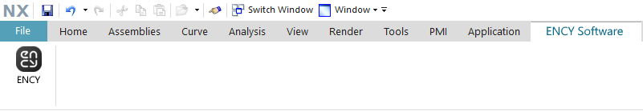

# Barra degli strumenti e add-in di importazione per NX™

La barra degli strumenti consente di esportare dati geometrici da <strong>NX™</strong>. È possibile visualizzare la versione del sistema CAD supportato. [Dettagli](10039.md)

L'add-in consente di importare file di progetto <strong><strong>NX™</strong></strong>.

Estensioni di file supportate: PRT. Per il funzionamento di questa opzione, l'applicazione richiesta (NX™) deve essere installata sul computer.
