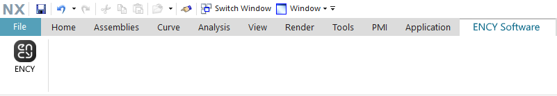

# NX™ ツールバー＆インポートアドイン

このツールバーは、 <strong>NX™</strong>から形状データをエクスポートできます。 [詳細を見る](10039.md)

このアドインを使用すると、 <strong>NX™</strong> プロジェクトファイルをインポートできます。

サポートされているファイル拡張子：PRT

> このオプションを使用するには、必要なアプリケーション <strong>（NX™）</strong>を コンピュータにインストールする必要があります。
