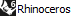
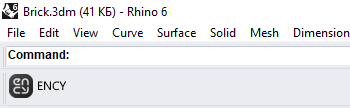

# Rhinoceros ツールバー＆インポートアドイン

このツールバーは、 <strong>Rhinoceros™</strong>から形状データをエクスポートできます。 [詳細を見る](10039.md)

このアドインを使用すると、<strong>Rhinoceros™</strong> のプロジェクトファイルをインポートすることができます。

サポートされているファイル拡張子： 3DM, RWS, 3DS, STP, STEP, RAW, WRL, VRML, AI, EPS, LWO, SPL, VDA, DWG, DXF, DGN, SLDPRT, SLDASM.

> このオプションを使用するには、必要なアプリケーション<strong>（</strong><strong>Rhinoceros™</strong><strong>）</strong>がコンピュータにインストールされている必要があります。
>
> データをレジストリに記録するには、 <strong>Rhinoceros™</strong> アプリケーションを少なくとも一度は実行し、終了する必要があります。そうでない場合、ツールバーはインストールできません。
