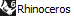
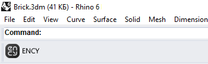

# Barra degli strumenti e add-in di importazione per Rhinoceros™

La barra degli strumenti consente di esportare i dati geometrici da Rhinoceros™. È possibile visualizzare la versione del sistema CAD supportato. [Dettagli](10039.md)

L'add-in consente di importare i file di progetto di <strong>Rhinoceros™</strong>.

Estensioni di file supportate: 3DM, RWS, 3DS, STP, STEP, RAW, WRL, VRML, AI, EPS, LWO, SPL, VDA, DWG, DXF, DGN, SLDPRT, SLDASM. Affinché questa opzione funzioni, l'applicazione richiesta (<strong>Rhinoceros™</strong>) deve essere installata sul computer. L'applicazione <strong>Rhinoceros™</strong> deve essere stata avviata e chiusa almeno una volta, in modo che i dati vengano registrati nel registro di sistema. In caso contrario, non sarà possibile installare la barra degli strumenti.
