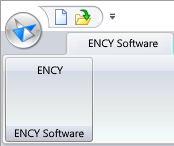

# Barra de ferramentas e suplemento de importação do SolidEdge™

A barra de ferramentas permite exportar dados geométricos do SolidEdge™. Consulte as versões suportadas do sistema CAD em [Detalhes](10039.md).

O suplemento permite importar arquivos de projeto do **SolidEdge™**.

Extensões suportadas: ASM, DFT, PAR, PSM, MDS, PWD, DGN, DXF, DWG, PRT, SAT, STP, STEP, X_B, X_T.

O SolidEdge™ deve estar instalado no computador para que o recurso funcione.
