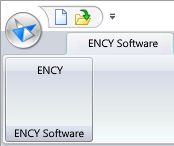

# SolidEdge™ ツールバー & インポート アドイン

このツールバーは、 SolidEdge™から形状データをエクスポートできます。 [詳細を見る](10039.md)

このアドインを使用すると、 <strong>SolidEdge™</strong> プロジェクト ファイルをインポートできます。

サポートされているファイル拡張子： ASM, DFT, PAR, PSM, MDS, PWD, DGN, DXF, DWG, PRT, SAT, STP, STEP, X_B, X_T.

> このオプションを使用するには、必要なアプリケーション<strong>（SolidEdge™）</strong>がコンピュータにインストールされている必要があります。
