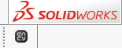

# Barra degli strumenti e add-in di importazione per SOLIDWORKS™

La barra degli strumenti consente di esportare i dati geometrici da SOLIDWORKS™. È possibile visualizzare la versione del sistema CAD supportato. [Dettagli](10039.md)

L'add-in consente di importare i file di progetto SOLIDWORKS™.

Estensioni di file supportate: SLDASM, ASM, SLDPRT, PRT, SLDDRW, DRW, X_B, X_T, STP, STEP. A partire da luglio 2026 sarà necessaria una licenza separata per utilizzare il modulo SolidWorks (vedere [Changes to ENCY–SOLIDWORKS Integration Licensing – ENCY CAD/CAM software](https://encycam.com/news/ency-solidworks-integration-licensing/)). Per il corretto funzionamento di questa opzione, l'applicazione richiesta (SOLIDWORKS™) deve essere installata sul computer.
