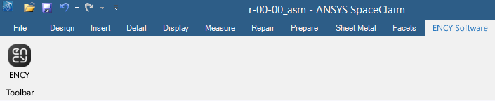

# SpaceClaim™ ツールバー＆インポートアドイン

このツールバーは、 SpaceClaim™.から形状データをエクスポートできます。 対応しているCADシステムのバージョンを確認できます。 [詳細を見る](10039.md)

このアドインを使用すると、 <strong>SpaceClaim™</strong> プロジェクトファイルをインポートできます。

サポートされているファイル拡張子： SLDASM, ASM, SLDPRT, PRT, SLDDRW, DRW, X_B, X_T, STP, STEP.

> このオプションを正しく動作させるには、必要なアプリケーション（<strong>SpaceClaim™</strong>）がコンピュータにインストールされている必要があります。
