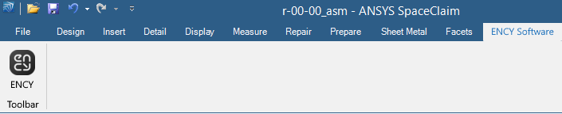

# Barra degli strumenti e add-in di importazione per SpaceClaim™

La barra degli strumenti consente di esportare dati geometrici da SpaceClaim™. È possibile visualizzare la versione del sistema CAD supportato. [Dettagli](10039.md)

L'add-in consente di importare i file di progetto di <strong>SpaceClaim™</strong>.

Estensioni di file supportate: SLDASM, ASM, SLDPRT, PRT, SLDDRW, DRW, X_B, X_T, STP, STEP. Per il corretto funzionamento di questa opzione, l'applicazione richiesta (SpaceClaim™) deve essere installata sul computer.
