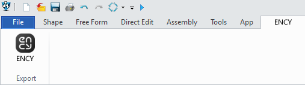

# ZW3D™ ツールバー＆インポートアドイン

このツールバーは、 <strong>ZW3D</strong>から形状データをインポートできます。 [詳細を見る](10039.md)

アドインは ZW3D™ プロジェクトファイルをインポートすることができます。

サポートされているファイル拡張子：Z3

> このオプションを正しく動作させるには、必要なアプリケーション（<strong>ZW3D™</strong>）がコンピュータにインストールされている必要があります。
