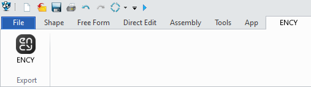

# ZW3D™: Symbolleiste und Import-Add-in

Über die Symbolleiste können Sie geometrische Daten aus ZW3D™ exportieren. Die unterstützten CAD-Versionen sind in der Übersicht aufgeführt. [Details](10039.md)

Mit dem Add-In können Sie ZW3D™-Projektdateien importieren.

Unterstützte Dateierweiterungen: Z3. Damit diese Option funktioniert, muss die erforderliche Anwendung (ZW3D™) auf Ihrem Computer installiert sein.
