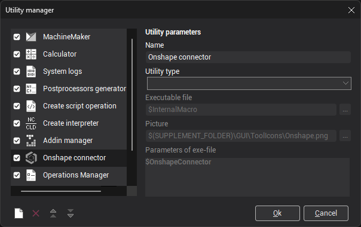
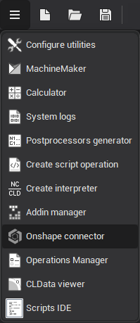

# Onshape™-Connector

<strong>Onshape™</strong> ist ein vollständig cloudbasiertes CAD-System für die Zusammenarbeit in Konstruktionsteams. Die unterstützten CAD-Versionen sind in der Übersicht aufgeführt. [Details](10039.md)

Um das <strong>Onshape-Connector-Plugin</strong> verwenden zu können, muss es zunächst im Fenster <strong>Configure utilities</strong> (Dienstprogramme konfigurieren) aktiviert werden.

Nach der Aktivierung kann das Plugin durch Klicken auf das Symbol <strong>Onshape</strong> in der Symbolleiste gestartet werden.

Nachdem Sie sich bei Ihrem Onshape-Konto angemeldet haben, zeigt das Plugin eine Liste der verfügbaren Modelle an. Durch die Auswahl eines Modells aus dieser Liste wird der Importvorgang gestartet. Wenn das importierte Modell später in Onshape aktualisiert wird, werden Sie vom Connector-Plugin aufgefordert, das Modell erneut zu importieren. Das <strong>Onshape-Connector-Plugin</strong> behält die [Assoziativität des Modells](10057.md) bei und stellt so sicher, dass Aktualisierungen in Ihrem Arbeitsbereich widergespiegelt werden.
