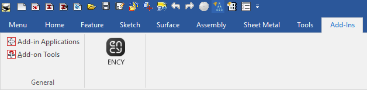

# Barra degli strumenti CAXA 3D™

La barra degli strumenti consente di esportare i dati geometrici da <strong>CAXA 3D™</strong> al sistema CAM. È possibile visualizzare la versione del sistema CAD supportato. [Dettagli](10039.md)

Una volta installata, la barra degli strumenti potrebbe non comparire in <strong>CAXA 3D™</strong>. In tal caso è necessario premere

nella finestra di dialogo per attivarla:

Estensioni di file supportate: ICS, IC3D, ICSW, EXB. Affinché questa opzione funzioni, l'applicazione richiesta (<strong>CAXA 3D™</strong>) deve essere installata sul computer.
