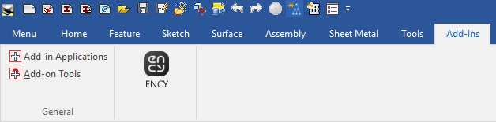

# CAXA 3D™ ツールバー

ツールバーを使用すると、<strong>CAXA 3D™</strong> からCAMシステムへ幾何データをエクスポートできます。 また、対応しているCADシステムのバージョンを確認することができます。 [詳細を見る](10039.md)

インストール後、<strong>CAXA 3D™</strong> にツールバーが表示されない場合があります。

その場合は、ダイアログボックス内で以下を選択して有効化してください。

対応ファイル拡張子：ICS、IC3D、ICSW、EXB このオプションを使用するには、必要なアプリケーション（<strong>CAXA 3D™</strong>）をコンピュータにインストールする必要があります。
