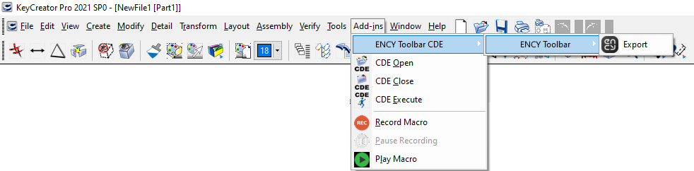

# KeyCreator™ ツールバー

このツールバーは、 <strong>KeyCreator™</strong>から形状データをエクスポートできます。対応するCADシステムのバージョンも確認できます。 [詳細を見る](10039.md)

サポートされているファイル拡張子：CKD。この機能を使用するには、コンピューターに<strong>KeyCreator™</strong>がインストールされている必要があります。
