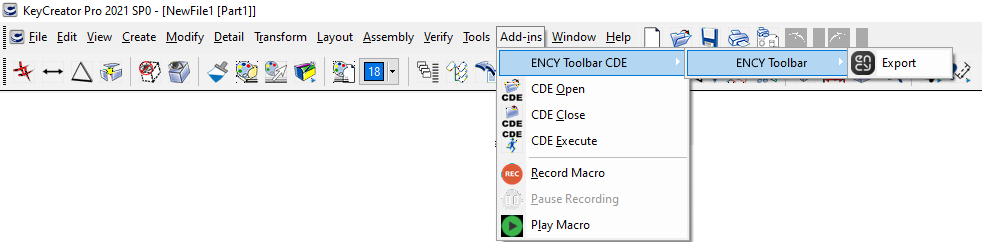

# KeyCreator™ ツールバー

このツールバーは、 <strong>KeyCreator™</strong>から形状データをエクスポートできます。 [詳細を見る](10039.md)

サポートされているファイル拡張子：CKD

> このオプションを正しく動作させるには、必要なアプリケーション（<strong>KeyCreator</strong><strong>™</strong>）をコンピュータにインストールする必要があります。
