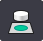
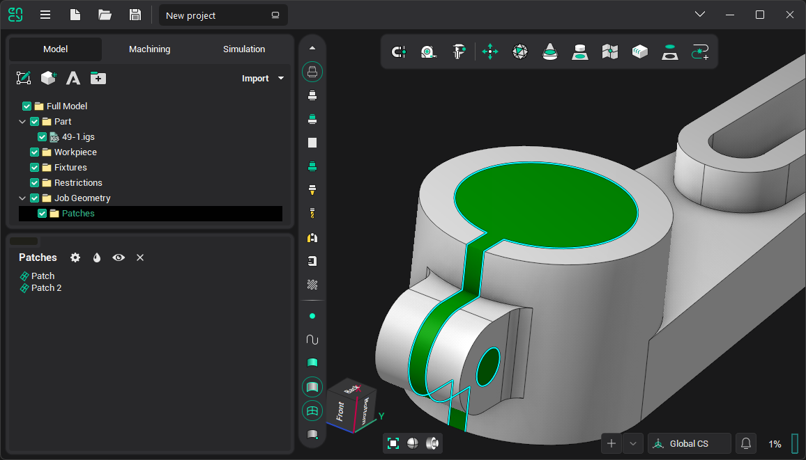
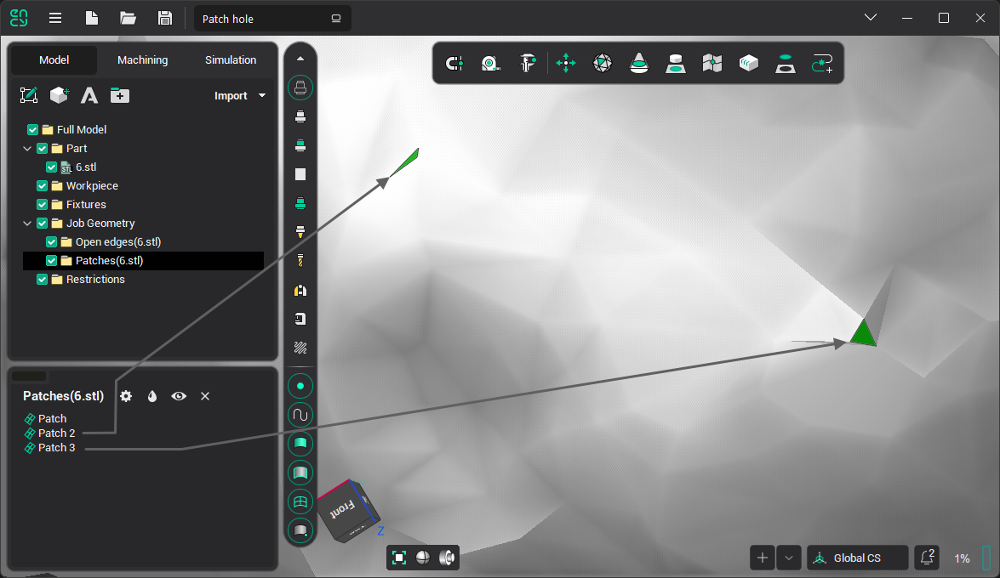

# Chiusura dei fori

La funzione di chiusura dei fori consente di generare la triangolazione degli spigoli o delle mesh selezionati. La funzione si richiama premendo questo pulsante - , nella pagina "Model". Per impostazione predefinita il pulsante non è attivo. Per attivarlo, selezionare nella finestra grafica o nell'albero del modello gli spigoli o le mesh di cui si desidera chiudere i fori.

La funzione opera in modo diverso per spigoli e mesh:

1. <strong>Spigoli</strong>. Dapprima vengono individuati gli spigoli chiusi e quelli aperti. Per quelli chiusi la triangolazione viene generata immediatamente. Con tutti gli altri spigoli viene formato uno spigolo chiuso, per il quale viene anch'essa generata la triangolazione. 
2. <strong>Mesh</strong>. Nelle mesh viene dapprima eseguito un controllo della topologia. Se vengono trovati spigoli aperti, si formano contorni chiusi. Quindi viene generata la triangolazione per tutti i contorni. A differenza della prima opzione, in questo caso all'albero del modello vengono aggiunti, oltre alle nuove mesh, anche i contorni chiusi lungo i quali è stata generata la triangolazione. 
